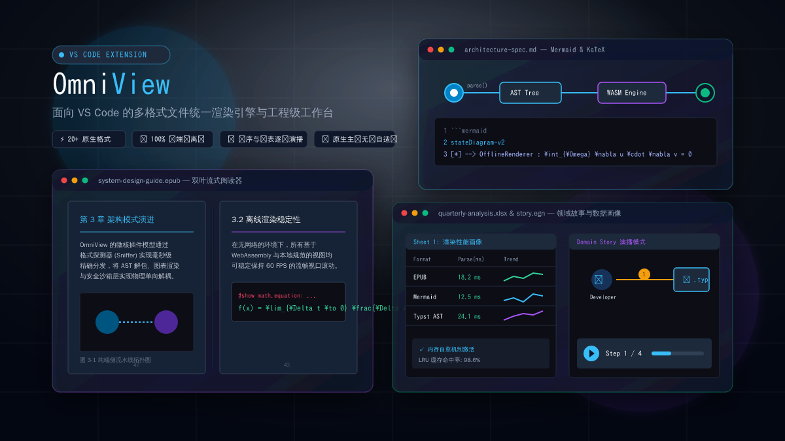

# OmniView

[中文](./README.md) | **English**

<p align="left">
  <a href="https://marketplace.visualstudio.com/items?itemName=zhouzan.omniview"></a>
  <a href="./LICENSE"></a>
  <a href="./docs/architecture.md"></a>
  <a href="#"></a>
  <a href="#"></a>
  <a href="#"></a>
  <a href="./CONTRIBUTING.md"></a>
</p>

> OmniView is a developer-centric **multi-format file visualization and editing workbench**, available as both a **VS Code extension** and a **standalone web application**. Built on React 19, TypeScript, and Vite, it delivers **100% client-side, offline high-fidelity rendering** across **23+ formats** including technical documents, diagrams, mind maps, whiteboards, modern office files, cloud-native manifests, and structured data.

<p align="left">
  <a href="https://ais-pre-3kity5ft64rqesjejxmxsu-168296143482.us-east1.run.app"><b>Live Web Demo</b></a> ·
  <a href="https://github.com/fsyyzz/OmniView/releases"><b>Download VSIX</b></a> ·
  <a href="./docs/features-capabilities.md"><b>Features Manual</b></a> ·
  <a href="./docs/architecture.md"><b>Architecture Docs</b></a> ·
  <a href="https://github.com/fsyyzz/OmniView/issues"><b>Feedback & Requests</b></a>
</p>



---

## Why OmniView

Previewing common file formats in VS Code usually requires installing a dozen separate extensions, many of which depend on external cloud services or feature inconsistent visual styles. OmniView consolidates these capabilities into a single microkernel architecture:

| Dimension | Vanilla VS Code | Fragmented Standalone Extensions | OmniView |
| :--- | :--- | :--- | :--- |
| **Supported Formats** | Plain text & syntax coloring only | Requires 8–15 separate extensions | **23+ formats out of the box** (Documents, Diagrams, Mindmaps, Office, PDF, Cloud-Native, etc.) |
| **Network & Privacy** | Offline | Frequently relies on cloud services or paid APIs | **100% client-side offline**, zero telemetry, automated secret masking |
| **Office Trio (DOCX / PPTX / XLSX)** | Not supported | Requires external runtimes or desktop Office | **Pure client-side OOXML decoding**, XLSX sparklines & profiling, PPTX vector slide playback |
| **Markdown Copy to Word/WPS** | Broken borders, dead images, ruined formatting | Manual screenshots or image-by-image export | **Built-in clipboard sanitizing pipeline**, diagrams rasterized to high-res PNGs, native code tables |
| **Host Theme Harmony** | Native | Fragmented UI across plugins | **14 rendering themes**, seamless integration with `--ov-*` and host VS Code design tokens |
| **Long Document Performance** | Good | Complex multi-diagram documents freeze or crash | **Unloadable lazy viewport (`LazyViewportBlock`) & FNV-1a incremental dirty reuse** |

### Common Use Cases

1. **Lossless Technical Document Copying to Word / WPS**: Filters out interactive toolbar chrome, transforms code blocks into native two-column Word tables, and rasterizes Mermaid, PlantUML, and Graphviz diagrams into high-resolution inline PNGs.
2. **Instant In-Editor Previews for DOCX, PPTX & XLSX**: Zero external dependencies. XLSX provides multi-sheet tabs, column data profiling, and sparkline micro-charts; PPTX provides 16:9 / 4:3 vector fullscreen presentations.
3. **Complex Configurations to Mindmaps & Topologies in One Click**: Project JSON, YAML, and XML into interactive mind maps or microservice topologies, with JSONPath extraction and sensitive field masking.

---

## Supported Formats & Capabilities Overview

OmniView employs a unified driver routing matrix. Below is an overview of supported domains (for comprehensive technical specifications, refer to **[docs/features-capabilities.md](./docs/features-capabilities.md)**):

| Domain | Core Formats | Highlights & Core Capabilities |
| :--- | :--- | :--- |
| **Technical Docs & Academia** | **Markdown** (`.md`), **Word** (`.docx`), **PDF** (`.pdf`), **EPUB** (`.epub`), **Typst** (`.typ`), **Jupyter** (`.ipynb`) | • **Markdown**: Mermaid / PlantUML / Graphviz / KaTeX mixing, FNV-1a incremental diffing, in-place block CRUD editing, and selection formatting<br>• **Word**: A4 print-faithful pagination, paper/parchment/dark reading modes, one-click PDF export<br>• **PDF**: Mozilla PDF.js v4+ rasterizer, cursor-anchored focal zoom, side-by-side spread reading<br>• **EPUB**: Dual-page spread layout, 3D page flip transitions, reading progress persistence<br>• **Typst**: Pure client-side AST compiler, A4 2.0 print pagination, and KaTeX math formulas<br>• **Jupyter**: v4 format offline rendering, execution counter badges, ANSI traceback coloring |
| **Diagrams & Architecture** | **DDD Studio** (`.ddd`), **Mermaid** (`.mmd`), **PlantUML** (`.puml`), **Graphviz** (`.dot`), **Markmap** (`.markmap`), **Excalidraw** (`.excalidraw`), **SVG Studio** (`.svg`) | • **DDD Modeling**: Unified `.ddd` format for Domain Storytelling, Event Storming, Context Map, Core Domain Chart, and Context Canvas, with multi-group stage-flow horizontal layout & step player<br>• **Diagram Engines**: Mermaid 14-theme panorama, PlantUML sequence/mindmap, Graphviz DOT 7 WASM layout engines with native vector solidifier<br>• **Markmap / Mindmap**: Bidirectional split-screen source editing and interactive outline navigation<br>• **Excalidraw**: Interactive whiteboard canvas, schema self-healing, preset architecture templates<br>• **SVG Studio v2**: Immutable document model, 8 core vector tools, polyline midpoint evolution |
| **Office & Data Insights** | **Excel** (`.xlsx`, `.xls`), **CSV / TSV** (`.csv`, `.tsv`), **PowerPoint** (`.pptx`), **Modern Images** (`.png`, `.jpg`, `.webp`, `.gif`, `.svg`, etc.) | • **Excel**: Pure client-side multi-sheet decoding, column data profiling, quantile metrics, and sparklines<br>• **CSV / TSV**: RFC 4180 parsing, sticky headers, fast full-text filtering, multi-column sorting<br>• **PowerPoint**: Client-side vector slide presentation, speaker notes drawer, keyboard navigation<br>• **Image & Eyedropper**: 10%~3200% smooth zoom, 16x floating magnifier eyedropper, EXIF metadata extraction |
| **Cloud-Native & Config** | **Dockerfile**, **Docker Compose** (`.yml`), **Kubernetes** (`.yaml`), **Structured Data** (`.json`, `.yaml`, `.toml`, `.xml`), **HTML5** (`.html`) | • **Dockerfile**: Multi-stage build DAG dependency flow, instruction layering, static best-practice linting<br>• **Docker Compose**: Service dependency topology, network cluster isolation, volume graphs, secret masking<br>• **Kubernetes**: 4-tier gravity topology, cross-resource selector auto-linking, missing probe diagnostics<br>• **Structured Data**: Bidirectional JSON ⇄ YAML ⇄ TOML ⇄ XML offline conversion & mindmap projection<br>• **HTML5 Sandbox**: Strict dual-layer iframe sandbox, desktop/tablet/mobile viewport simulation, split editing |

> [!TIP]
> For in-depth technical specifications, driver lifecycle contracts, and architectural designs:
> - 📖 **[Features & Capabilities Evaluation Manual (docs/features-capabilities.md)](./docs/features-capabilities.md)**
> - 🛠️ **[Viewer Driver Architecture & Lifecycle Specifications (docs/design/viewer-drivers.md)](./docs/design/viewer-drivers.md)**
> - 📐 **[Markdown Rendering Pipeline & In-Place Editing Specifications (docs/design/markdown-pipeline.md)](./docs/design/markdown-pipeline.md)**

---

## Quick Start

### Local Development

```bash
# 1. Clone the repository and install dependencies
git clone https://github.com/fsyyzz/OmniView.git
cd OmniView
npm install

# 2. Launch the local development server (runs on http://localhost:3000)
npm run dev
```

### Automated Testing & Quality Gates

```bash
# Run the complete test suite (101/101 test suites)
npm test

# Run full physical verification & build (TypeScript check, Codex Linter, doc consistency, architecture validation)
npm run verify
```

### Settings & State Persistence

OmniView features a built-in cross-version settings migration and state persistence architecture (`settingsStorage`):
- **Workspace & Global Configuration Persistence**: Theme, font sizing, split ratios, outline state, and language preferences are stored in VS Code workspace or global settings;
- **Render State & Edit Caching**: Automatically persists local edit snapshots and pan/zoom coordinates offline, seamlessly restoring user context upon reopen.

### Building the VS Code Extension (VSIX)

```bash
# 1. Build the production bundle
npm run build:plugin

# 2. Package into an offline VSIX bundle
npm run package:vsix

# 3. Install into your local VS Code editor
code --install-extension omniview-1.4.44.vsix --force
```

After installation, right-click any supported file in the VS Code Explorer and choose **"Open with OmniView"**, or click **"Open Preview to the Side"** in the top-right editor title bar.

---

## Documentation Hub

All deep architectural designs, subsystems, and RFC proposals reside in the [`docs/`](./docs) directory:

| Path | Core Content |
|---|---|
| [`docs/README.md`](./docs/README.md) | **Technical Documentation Index**: Navigation map and reading paths across docs |
| [`docs/architecture.md`](./docs/architecture.md) | **System Architecture**: Layering, IPC protocols, security sandbox, and CI gates |
| [`docs/features-capabilities.md`](./docs/features-capabilities.md) | **Features & Capabilities Manual**: Detailed 23+ format specifications and 6D radar |
| [`docs/design/viewer-drivers.md`](./docs/design/viewer-drivers.md) | **Viewer Driver Design**: Lifecycle, props contracts, and error resilience |
| [`docs/design/markdown-pipeline.md`](./docs/design/markdown-pipeline.md) | **Markdown Pipeline**: Incremental diffing, in-place CRUD, and Word clipboard sanitizing |
| [`docs/design/svg-v2-editor.md`](./docs/design/svg-v2-editor.md) | **SVG v2 Vector Engine**: Immutable document model, command pipeline, polyline evolution |
| [`docs/design/cloud-native-viewers-plan.md`](./docs/design/cloud-native-viewers-plan.md) | **Cloud-Native Drivers**: Dockerfile, Compose, and K8s topology designs |
| [`docs/design/persistence-storage.md`](./docs/design/persistence-storage.md) | **Persistence Subsystem**: Schema v2, migration pipeline, and boundary clamping |
| [`CONTRIBUTING.md`](./CONTRIBUTING.md) | **Contribution Guide**: Branching model, Conventional Commits, and PR checklist |
| [`SECURITY.md`](./SECURITY.md) | **Security Policy**: Vulnerability disclosure channels and response procedures |
| [`CHANGELOG.md`](./CHANGELOG.md) | **Release Notes**: Version history adhering to Keep a Changelog |

---

## Open Source Samples

OmniView provides sample files across all supported formats in the [`examples/`](./examples) directory. See [`examples/README.md`](./examples/README.md) for details.

## License

OmniView is open-sourced under the [MIT License](./LICENSE). Feel free to submit [Issues](https://github.com/fsyyzz/OmniView/issues) or contribute via [CONTRIBUTING.md](./CONTRIBUTING.md).
