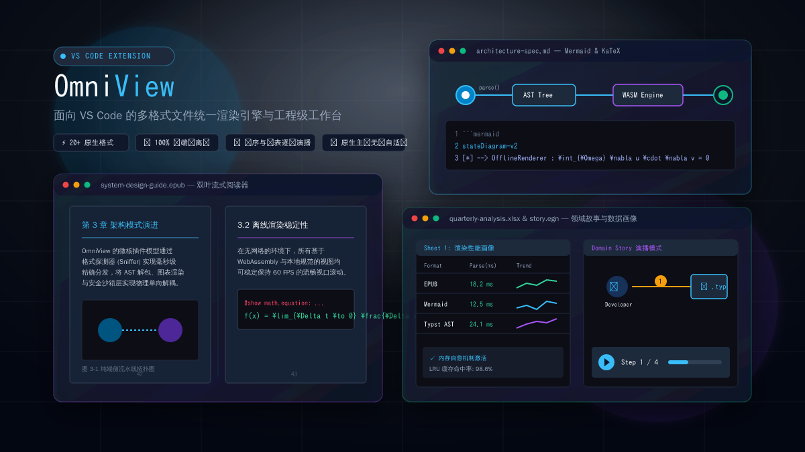

# OmniView

**中文** | [English](./README.en.md)

<p align="left">
  <a href="https://marketplace.visualstudio.com/items?itemName=zhouzan.omniview"></a>
  <a href="./LICENSE"></a>
  <a href="./docs/architecture.md"></a>
  <a href="#"></a>
  <a href="#"></a>
  <a href="#"></a>
  <a href="./CONTRIBUTING.md"></a>
</p>

> OmniView 是一个多格式文件可视化工作台，提供 VS Code 扩展与独立 Web 两种使用方式。基于 React 19、TypeScript、Vite 6 与 Tailwind CSS v4 构建，支持文档、图表、思维导图、矢量绘图、数据表格、云原生清单与结构化配置等 23+ 种格式的本地离线渲染。

<p align="left">
  <a href="https://ais-pre-3kity5ft64rqesjejxmxsu-168296143482.us-east1.run.app"><b>在线体验 (Web Demo)</b></a> ·
  <a href="https://github.com/fsyyzz/OmniView/releases"><b>下载离线 VSIX</b></a> ·
  <a href="./docs/architecture.md"><b>系统架构文档</b></a> ·
  <a href="https://github.com/fsyyzz/OmniView/issues"><b>反馈与格式提案</b></a>
</p>



---

## 为什么选择 OmniView

在 VS Code 中预览常见文件格式，往往需要分别安装多个扩展，其中不少还依赖在线服务。OmniView 将这些能力收敛到一个基于统一微内核架构的扩展中：23+ 种格式开箱即用，全部计算在本地完成，界面跟随 VS Code 主题，长文档滚动保持稳定帧率。

| 评估维度 | 原生 VS Code | 传统独立插件组合 | OmniView |
| :--- | :--- | :--- | :--- |
| **支持文件格式** | 仅纯文本/代码着色 | 需安装 8~12 个扩展 | **23+ 格式开箱即用**（云原生/HTML5/TOML/Office/PDF/EPUB/Typst/图表/导图/白板/数据） |
| **网络与隐私** | 离线 | 多数依赖外部云端或收费 API | **100% 前端离线**，零云端调用，敏感字段自动脱敏 |
| **Office 三件套 (DOCX/PPTX/XLSX)** | 不支持 | 需安装外部运行时 | **纯前端 OOXML 解包**，XLSX 标签页与列画像、PPTX 矢量放映 |
| **Markdown 复制到 Word / WPS** | 边框全黑、图片失效、排版错乱 | 需逐张导出图片再插入 | **内置剪贴板双通道清洗**，矢量图自动光栅化为高分辨率位图 |
| **主题与视觉融合** | 原生跟随 | 各插件 UI 风格不一 | **跟随 `--ov-*` 与 VS Code 宿主设计令牌** |
| **超长文档流畅度** | 良好 | 复杂图表易引起卡顿 | **可卸载懒视口 (`LazyViewportBlock`) 与 FNV-1a 增量脏复用** |

### 典型使用场景

1. **把技术文档复制到 Word / WPS 时保持排版**
   剪贴板清洗流水线过滤交互悬浮条与冗余边框，代码块转换为 Word 原生双列表格，Mermaid/PlantUML/Graphviz 图表自动转为内联高分辨率 PNG。
2. **在编辑器内直接打开 DOCX、PPTX 与 XLSX**
   纯前端离线解包：XLSX 支持多工作表切换、列画像统计与迷你图；PPTX 支持 16:9 / 4:3 矢量放映。
3. **阅读数百行的 JSON 与微服务配置**
   JSON/YAML/XML 可转换为交互式思维导图与云原生服务依赖拓扑图，带敏感字段脱敏与 JSONPath 快速提取。

---

## 核心功能

### 1. 结构化数据工作台 (Structured Data Studio)
针对 **JSON、YAML、TOML、XML**，在纯文本查看之外提供多种视图投影：
- **交互式层级结构树 (Tree View)**:
  - 类型色彩映射（String/Number/Boolean/Null/Object），带数组/对象项数徽标与层级连接线；
  - 支持一键展开/折叠至首层，支持 Key / Value 的结构感知全文检索；
  - **KeyPath 路径检视器**：点击节点自动解析并复制标准 JSONPath（如 `$.services.web.ports[0]`）。
- **思维导图投影 (Mindmap Projection)**:
  - 将深层嵌套结构转换为可交互的矢量思维导图；
  - 支持平移缩放、节点分级折叠、大纲导航与 SVG 导出。
- **同构数组下钻 (Array to Interactive Table & Chart)**:
  - 自动识别根节点或首层同构对象数组（如 `cluster_nodes`、`items`、`users`），可下钻至交互式数据表格；
  - 表格支持吸顶表头、排序、全文过滤，数值序列可生成柱状/折线微图表。
- **云原生服务依赖拓扑图 (Topology View)**:
  - 自动识别 Docker Compose 或微服务编排中的 `services`、`depends_on`、`ports` 与网络流向；
  - 生成服务依赖拓扑图。
- **敏感字段脱敏 (Secret Masking)**:
  - 自动探测 `password`、`token`、`secret`、`jwt`、`api_key` 等敏感字段；
  - 可在【脱敏遮罩】（悬浮临时查看原值）与【明文模式】间切换，适用于投屏演示与截图场景。
- **跨格式离线互转 (Format Converter)**:
  - 支持 **JSON ⇄ YAML ⇄ TOML ⇄ XML** 双向实时互转；
  - 支持美化缩进 (Pretty) 与紧凑压缩，可复制或下载转换结果；
  - **本地内存序列化**，不发起网络请求。

### 2. Markdown 渲染引擎
- **多引擎图表矩阵**:
  - **Mermaid.js**：流程图、时序图、类图、状态机图 (stateDiagram / stateDiagram-v2，深浅主题自适应)、Git 提交历史图、甘特图、C4 架构图等；
  - **PlantUML**：架构图、时序图、组件图，支持【可视化预览 / 源码编辑】双向渲染与私有服务地址配置；
  - **Graphviz / DOT**：支持 Markdown 内嵌 ````dot```` 与 ````graphviz```` 代码块，基于 `@hpcc-js/wasm-graphviz` 离线 WebAssembly 引擎与 Web Worker 异步计算；
  - **SVG 矢量图**：支持内联 ````svg```` 代码块与本地相对路径 `.svg` 引用，支持深色/网格/浅色背景切换；
- **KaTeX 数学公式**:
  - 行内公式 `$E=mc^2$`，含货币价格防误触过滤（如 `$100`、`$5.99` 不被识别为公式）；
  - 块级多行对齐方程组 `$$\int_{-\infty}^{+\infty} e^{-x^2} dx = \sqrt{\pi}$$`；
  - 支持 ````math````、````katex````、````latex```` 代码块排版；
- **交互式数据表格**:
  - 为 Markdown 表格注入吸顶表头与横向滚动容器，避免超宽表格破坏排版；
  - 单元格支持行内代码与徽标渲染；
  - **排序**：字符串拼音/字母排序、数值排序、带单位数值排序（如 `128MB` vs `2GB`、`15ms` vs `1.2s`）与日期时间排序；
  - **列图表化**：自动识别数值序列并生成柱状图或折线图；
  - 支持表格内容复制、导出为 CSV 或 Markdown。
- **图片/图表灯箱 (Lightbox)**:
  - 正文图片与图表支持全屏或双击唤起灯箱；
  - `0.2x ~ 5.0x` 滚轮缩放、拖拽平移、90° 旋转、复制与下载；
- **增量重渲染与视口卸载 (Zero CLS & Lazy Viewport)**:
  - **基于 FNV-1a 内容指纹与行号范围复用**：局部编辑时精准识别脏块并复用未变块对象引用，避免整篇重算；
  - **可卸载型视口内存管理**：重型图表（Mermaid、Graphviz、KaTeX、宽表）移出视口时自动卸载释放 DOM 与 WASM 资源，配合高度记忆池保证回访时无布局抖动 (Zero CLS)；
- **块级原地编辑与 CRUD (In-place Block CRUD Engine)**:
  - **块级悬浮动作胶囊 (`MarkdownBlockActionBar`)**：在段落/表格/图表块右上角提供快速操作，支持插入新块、克隆副本、相邻块位置互换；
  - **专注编辑与防误触撤销**：内置「纯源码 / 左右实时微预览」双态专注编辑卡片 (`MarkdownFocusedBlockEditor`)，删除块支持行内二次确认与 6 秒可撤销浮条 (`MarkdownBlockUndoToast`)，空行智能归一化；
- **划选格式化与安全回写 (Selection-to-Source Replacer)**:
  - 单行选区支持加粗 (`**B**`)、斜体、删除线 (`~~S~~`)、高亮 (`==H==`)、上下标、键盘徽标 (`<kbd>`)、行内代码、超链接与双向链接 (`WikiLink`)；
  - 跨行选区切换为块级模式，支持转为引用块 (`>`)、代码围栏与 Callout 警示框 (`[!NOTE]` / `[!TIP]` / `[!WARNING]`)；
  - 支持预览窗内图片拖拽缩放并回写 `` 源码；
  - 写入前进行行号与上下文文本指纹 (Fingerprint) 双重校验，不匹配时拒绝写入，防止破坏源文档；
- **渲染耗时监控 (Render Time Budget)**:
  - 单块渲染耗时超过 800ms 预算门限时自动降级为源码卡片并支持重试，大纲目录中标注 `ZapOff` 慢块徽章；
- **错误边界 (RenderErrorBoundary)**:
  - 块级隔离，单个图表语法损坏时局部展示诊断卡片与修复建议，文档其余部分保持可用；
- **目录大纲与检索**:
  - 标题节点真实挂载，大纲与“跳转到标题”定位准确；
  - 可折叠多级大纲，滚动联动定位 (Scroll Spy)；
  - 关键词全文搜索与命中高亮。

### 3. 思维导图 (Mindmap Studio)
- 支持 `.markmap`、`.mm`、`.mindmap`、`.km` 扩展名与双向实时联动；
- 支持【代码编辑 / 分屏对比 / 纯导图】三种视图模式，提供 30:70、50:50、70:30 分屏预设与自由拖拽调节；
- 内置 Markdown 语法快捷模板与快捷键（Tab / Shift+Tab 缩进、Enter 自动续行续级）；
- 缩放、居中自适应与 SVG 矢量导出。

### 4. SVG 矢量编辑器 (SVG Studio v2)
- **不可变文档模型与命令管线**：支持无限 Undo/Redo 历史栈与结构共享快照；
- **8 种核心矢量工具**：选择 (`select`)、锚点编辑 (`node`)、贝塞尔钢笔 (`pen`)、矩形 (`rect`)、椭圆 (`ellipse`)、直线 (`line`)、箭头 (`arrow`) 与文本 (`text`)；
- **鼠标拖拽起绘**：拖拽动态拉伸出实时半透明预览；Shift 约束等比正方形/正圆/15° 步进角度，Alt 从中心起绘，原地单击自动取消；
- **双端点箭头与独立微调**：独立箭头工具（快捷键 `W`）拖拽即成；选中线条/箭头呈现虚线轴线与两端点控制柄，可单独拖拽端点微调，支持一键反向 (`ArrowLeftRight`)；
- **直线向折线演化**:
  - **幽灵中点折叠手柄 (Ghost Midpoints)**：拖拽直线中点手柄即可拉出新折点转化为折线，双击折点或删除折点可恢复为直线；
  - **直角走线风格一键转换 (`path.convertLineStyle`)**：属性栏与悬浮 HUD 支持「直线 ↔ Z形直角 ↔ V形直角 ↔ L形单折角」切换；
- **开发者导出**：图元行号反向代码定位、SVGO 净化、一键生成 React JSX 组件、Vue 3 组件或 Base64 Data URI。

### 5. EPUB 电子书阅读器 (EPUB Reader Studio)
- 支持 `.epub` 电子书流式渲染与解包阅读；
- **三种流式阅读形态 (Flow Modes)**:
  - **双叶并排跨页 (Two-Page Spread)**：基于 CSS Multi-Column 的并排开本排版，中缝书脊折痕与光影，窄屏自动降级；
  - **单页流式分页 (Single-Page Flow)**：单栏居中留白，配合悬浮翻页热区与方向键/空格翻页；
  - **连续流式滚动 (Continuous Scroll)**：纵向滚动阅读，支持章节底栏切换与滚动百分比感知；
- **3D 翻书动效 (Page Flip Effect)**：GPU 加速的页面翻转光影过渡，可随时开关；
- **排版偏好与阅读进度持久化 (`epubSettingsStorage`)**：字号 (A-/A+)、字体族（宋体/黑体/楷体/等宽）、首行缩进、两端对齐/靠左、行距倍率（1.5x/1.75x/2.0x）、版心宽度、阅读主题（自动/羊皮纸/明亮/夜间）与书籍阅读进度（章节、页码、百分比）自动持久化。

### 6. PDF 阅读器 (PDF Reader)
- 基于 Mozilla PDF.js v4+ 光栅化内核，支持二进制解析与 Hi-DPI Canvas 渲染；
- **光标锚定缩放 (Focal Point Wheel Zoom)**：Ctrl/Cmd + 滚轮及触控板捏合无级缩放，光标所在内容像素保持稳定，配合 `useLayoutEffect` DOM 几何同步；
- **缩放过程无白屏闪烁**：缩放期间以 CSS GPU 加速即时缩放上帧位图承托，后台完成高分辨率矢量渲染后替换；
- **抓手漫游模式 (Hand Pan Tool & Space+Drag)**：文本选词/抓手模式切换，长按空格或鼠标中键开启自由平移；
- **缩放预设菜单**：50%、75%、100% 实际大小、125%、150%、200%、300%、400%、500%、适合宽度 (W)、适合整页 (H)；
- **视口居中 HUD 胶囊**：滚轮缩放时在底部中央显示半透明指示胶囊，带百分比与线性刻度条；
- **三重视图排版**：多页连续滚动、单页翻页与双页并排开本；
- **批注、大纲与检索**：全文跨页检索高亮、多级大纲书签树、划词高亮批注与 Markdown 导出、快照 PNG 导出与系统打印。

### 7. Excalidraw 手绘白板 (Excalidraw Whiteboard Studio)
- 支持 `.excalidraw` 手绘工程文件解析与交互；
- **四种工作模式**：交互白板 (Canvas Studio)、双向分屏 (Split)、只读预览 (Preview) 与 JSON 源码编辑 (Source Code)；
- **数据自愈与容错**：内置 `sanitizeExcalidrawElements` 与 `restoreElements`，自动修补异常图元字段并提供多级错误边界；
- **预置模板与导出**：内置系统架构、微服务调用、敏捷看板等 8 类预置模板，支持 SVG、PNG 及 `.excalidraw` 文件导出。

### 8. Typst 学术排版 (Typst Studio & A4 2.0)
- 基于纯端侧 AST 编译器与 A4 2.0 排版引擎，支持 `.typ` 与 `.typst` 文件；
- **排版能力**：标题大纲抽取、物理分页符、多页 SVG 连续渲染、KaTeX 矢量公式与中文字宽防重叠；
- **A4 2.0 打印**：动态页眉页脚宏变量（`{{page}}`、`{{totalPages}}`、`{{title}}`、`{{date}}`）、双面装订线奇偶页交替与标准 `@page` 打印规则。

### 9. Jupyter Notebook (.ipynb v4)
- 纯前端离线解析渲染 Jupyter Notebook v4 文件结构；
- 支持 Markdown 叙事单元格、Python 代码单元格高亮、执行计数器徽标、多格式输出与 ANSI Traceback 高亮转换；
- 支持整本 Notebook 导出为 Markdown (`.md`) 或 Python 脚本 (`.py`)。

### 10. CSV / TSV 数据表格
- 符合 RFC 4180 规范的解析引擎，支持双引号转义、跨行单元格与参差列宽归一化；
- 关键字过滤、多列排序、分页浏览、统计概览与数据导出。

### 11. OKF (Open Knowledge Format) 知识卡片
- 识别 `.okf` 文件及 Markdown Frontmatter OKF 元数据头；
- 抽取 Knowledge ID、版本标签、分类 Tags 与知识摘要并渲染为知识卡片。

### 12. Word (.docx) 文档渲染器 (Word Viewer)
- 基于 OOXML 标准与 `docx-preview` 前端流水线，支持 A4 纸张排版与连续滚动；
- 50% ~ 200% 缩放、复杂表格单元格合并与边框底纹、多级编号、嵌入图片与页眉页脚；
- 支持原纸、羊皮纸与夜间暗色反转三种视效，一键系统打印与 PDF 导出。

### 13. PowerPoint (.pptx) 幻灯片放映 (PowerPoint Viewer)
- 离线 OOXML 形状与资源解包，支持 16:9 / 4:3 矢量画布与等比缩放；
- 全屏放映（F5 / 点击播放）、键盘切页（`←` `→` / Space / PageUp / PageDown）；
- 左侧幻灯片缩略图大纲抽屉与底部演讲者备注 (Speaker Notes) 抽屉。

### 14. Excel (.xlsx / .xls) 多工作表查看 (Excel Spreadsheet)
- **纯前端离线 OOXML 引擎**：解包解析多工作表 (Multi-Sheet Tabs)、共享字符串池 (SharedStrings) 与隐藏表检测；
- **数据网格**：首行表头/列标切换、关键字高亮检索、单列排序、单元格复制与分页浏览；
- **列特征画像 (Data Profiling)**：类型推断、极值/均值/分位数统计与 Sparklines 迷你图；
- **多格式导出**：当前工作表导出为 CSV、TSV、JSON 或 Markdown 表格。

### 15. 图像查看器与像素检视器 (ImageViewer)
- **全格式支持**：`.png`、`.jpg`、`.jpeg`、`.gif`、`.webp`、`.bmp`、`.ico`、`.avif`、`.tiff` 等；
- **10% ~ 3200% 缩放**：滚轮平滑缩放与像素化 (`pixelated`) 渲染模式，自由平移与视口自适应；
- **16x 像素放大镜取色器**：浮动追踪光标，显示像素坐标 `(X, Y)` 与 `HEX` / `RGBA` / `HSLA` 色值，单击复制；
- **四态画布底色**：透明棋盘格 (Checkerboard)、纯黑、纯白与 VS Code 主题四态切换；
- **几何变换与导出**：顺时针/逆时针 90° 旋转、水平/垂直镜像翻转、复制 Base64 Data URI 与下载原图；
- **EXIF 元数据提取**：图像尺寸、总像素数、纵横比、文件大小与相机拍摄参数（光圈/快门/ISO/焦距/时间）。

### 16. 领域故事讲授法 (Domain Storytelling Studio)
- **多语法支持**:
  - 识别 WPS egon.io 官方 `.dst` JSON 规范、`.egn` 扩展及 `.domainstory` 文件；
  - Markdown 内嵌：支持 ````domainstory````、````story````、````dst````、````egn```` 声明式 DSL 及极简流语法；
- **领域拓扑与角色关系**:
  - 渲染参与者 (Actor: 人物、系统、组织)、工作对象 (Work Object: 文档、数据、包裹、消息等) 与带序号活动连接；
  - 支持领域协作边界圈层分组 (Groups) 与自适应启发式布局；
- **逐帧演播与导出**:
  - 接入 `DiagramStepPlayer` 播放器，支持按活动序号单步播放、前后帧切换与聚焦高亮；
  - 导出 `.dst` 文件与将领域模型嵌入的 **Polyglot SVG**，图形与源码可双向提取。

### 17. 云原生与容器化基础设施 (Cloud-Native Infrastructure Studio)
- **Dockerfile 构建流水线 (Dockerfile Studio)**:
  - 解析并生成多阶段构建流水线 DAG（如 `base -> builder -> runner`）；
  - 指令分层分类透视（基础镜像、构建步骤、环境配置、端口与运行时）；
  - 环境变量与暴露端口提取；
  - 静态体检：检测 `:latest` 镜像漂移、过多 RUN 碎片层、非 root 用户合规性等；
  - 源码分屏协同编辑。
- **Docker Compose 微服务拓扑 (Compose Studio)**:
  - 渲染服务依赖拓扑图，按服务关系自动关联连线；
  - 网络隔离簇 (Networks) 与持久化卷 (Volumes) 挂载图谱；
  - 配置矩阵：集中检视镜像版本、暴露端口、重启策略与资源参数；
  - 敏感环境变量脱敏 (Secret Masking)，悬浮临时查看；
  - 静态体检：检测端口冲突、悬空 depends_on 与未声明网络。
- **Kubernetes 清单拓扑 (Kubernetes Manifest Studio)**:
  - 离线解析多文档 YAML 清单（`---` 自动切分）；
  - 4 层依赖拓扑图：`Ingress / Gateway` → `Service` → `Workload (Deployment/StatefulSet/Pod/Job)` → `Config/Storage (ConfigMap/Secret/PVC)`；
  - 跨资源 Selector 自动连线：基于 `matchLabels` 关联 Service 与 Deployment，基于 `volumeMounts` 关联 PVC 与 ConfigMap；
  - 资源概览看板：按 Workload、Network、Config、Storage、RBAC 分类卡片聚合与检索；
  - 最佳实践体检：缺少存活/就绪探针 (Probes)、缺少 Resource Limits、Service 悬空断链警示与修复建议；
  - 源码分屏协同与跳转。

### 18. HTML5 网页沙箱 (HTML5 Web Sandbox Studio)
- **双层隔离安全沙箱**：受控 `iframe` 沙箱，禁用 `allow-same-origin` 与 `allow-top-navigation`，避免宿主逃逸与样式污染；
- **多终端视口模拟**：切换 **桌面 (100%)**、**iPad 平板 (768px)** 与 **iPhone 手机 (375px)**，自动居中排版；
- **多态画布底色**：纯白、深色、透明棋盘格 (Checkerboard) 与宿主主题四态切换；
- **本地源码分屏协同**：左侧代码编辑（Undo/Redo 历史栈与骨架片段库）+ 右侧沙箱防抖实时预览。

### 19. 全局偏好与工作区持久化
- **集中式配置中枢 (`settingsStorage.ts`)**：存储键升级为 `v2`，自动兼容迁移旧版本配置并安全回写；
- **边界防护**：对缩放比例 (0.5~2.5x)、字号 (12~22px) 及分屏比例进行截断与钳位，避免异常值影响交互；
- **多工作区生命周期持久化 (`fileStorage.ts`)**：记住侧边栏与资源管理器开关状态、活动标签页顺序与最后打开文件；
- **存储用量分析与备份**：统计 LocalStorage 占用量与键清单，支持工作区配置导出 JSON、校验导入与恢复出厂设置。

---

## 快速开始

### 本地开发预览

```bash
# 1. 安装项目依赖
npm install

# 2. 启动 Webview 本地调试服务器 (运行于 3000 端口)
npm run dev
```

### 自动化测试与工程门禁

```bash
# 运行全部单元测试与驱动验证套件
npm test

# 运行全量物理门禁与工程构建（含文档一致性与架构校验）
npm run verify
```

### 用户设置与状态持久化

OmniView 内置双向配置同步与持久化体系（`settingsStorage`）：
- **工作区与全局设置持久化**：主题风格、字号排版、分屏比例、大纲状态与多语言偏好保存在 VS Code 全局与工作区配置中；
- **渲染状态与历史持久化**：离线状态下自动持久化编辑缓存与缩放平移视图，下次打开恢复现场。

### 构建与打包 VS Code 插件 (VSIX)

```bash
# 1. 运行全量物理门禁与工程构建
npm run verify

# 2. 打包离线 VSIX 插件包
npm run package:vsix

# 3. 安装插件至本地 VS Code 编辑器（版本号与 package.json 保持一致）
code --install-extension omniview-1.3.42.vsix --force
```

安装完成后，在 VS Code 资源管理器中右键任意支持的文件，选择 **“使用 OmniView 文件渲染器打开”**，或在编辑器右上角点击 **“OmniView: 在侧边打开预览”**。

---

## 文档与协作

| 文档 | 说明 |
|---|---|
| [`docs/README.md`](./docs/README.md) | 文档总索引 |
| [`docs/architecture.md`](./docs/architecture.md) | 系统分层与渲染管道 |
| [`docs/features-capabilities.md`](./docs/features-capabilities.md) | 23 格式驱动能力全景与评估手册 |
| [`docs/design/svg-v2-editor.md`](./docs/design/svg-v2-editor.md) | SVG v2 矢量编辑引擎设计规范 |
| [`CONTRIBUTING.md`](./CONTRIBUTING.md) | 开发环境、门禁与 PR 约定 |
| [`SECURITY.md`](./SECURITY.md) | 安全漏洞披露流程 |
| [`CHANGELOG.md`](./CHANGELOG.md) | 版本变更记录 |

---

## 示例文件目录

OmniView 在 [`examples/`](./examples) 提供开箱即用的多格式样例（完整目录见 [`examples/README.md`](./examples/README.md)）：

| 示例文件 | 说明 |
|---|---|
| [`mermaid/omniview-render-pipeline.mmd`](./examples/mermaid/omniview-render-pipeline.mmd) | 独立 Mermaid 渲染流水线流程图 |
| [`plantuml/cloud-topology.puml`](./examples/plantuml/cloud-topology.puml) | 独立 PlantUML 微服务时序拓扑 |
| [`graphviz/cloud-architecture.dot`](./examples/graphviz/cloud-architecture.dot) | 独立 Graphviz 云原生有向拓扑 |
| [`markmap/system-architecture.markmap`](./examples/markmap/system-architecture.markmap) | 独立 Markmap 平台能力思维导图 |
| [`diagrams.md`](./examples/markdown/diagrams.md) | Mermaid、PlantUML、SVG 与 Graphviz / DOT 综合图表对比 |
| [`math-formulas.md`](./examples/markdown/math-formulas.md) | KaTeX 微积分、线性代数、物理学方程组与注意力公式 |
| [`graphviz-diagrams.md`](./examples/markdown/graphviz-diagrams.md) | Graphviz 分层微服务有向图、网络拓扑与错误降级自愈 |
| [`consensus-algorithms.md`](./examples/markdown/consensus-algorithms.md) | 分布式共识机制 (Raft, PBFT, PoW/PoS) 状态机与时序图 |
| [`technical-guide.md`](./examples/markdown/technical-guide.md) | 工程级混合技术文档（架构图、代码块与多态表格） |
| [`stability-stress-test.md`](./examples/markdown/stability-stress-test.md) | 语法损坏图表、缺失图片、超宽表格等极限压测与错误边界隔离 |
| [`domainstory/ecommerce-fulfillment.dst`](./examples/domainstory/ecommerce-fulfillment.dst) | 独立 WPS egon.io 官方 `.dst` 格式跨境电商履约领域故事模型 |
| [`markdown/domain-storytelling.md`](./examples/markdown/domain-storytelling.md) | Markdown 内嵌 Domain Storytelling DSL 敏捷与协同用例 |
| [`html/interactive-dashboard.html`](./examples/html/interactive-dashboard.html) | HTML5 响应式监控大屏、沙箱隔离脚本交互与多终端视口示例 |

---

## 开源许可证

本项目基于 [MIT License](./LICENSE) 开源。欢迎通过 [Issues](https://github.com/fsyyzz/OmniView/issues) 反馈问题，或阅读 [CONTRIBUTING.md](./CONTRIBUTING.md) 参与贡献。
