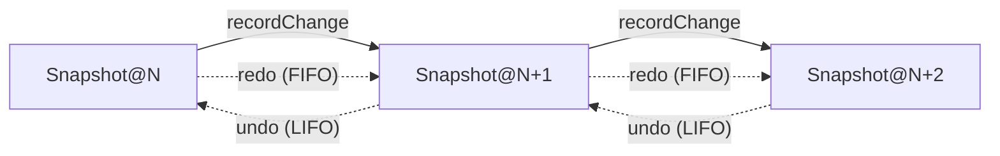

# ADR-0001: SVG 编辑引擎 v2 — 引入文档模型与命令管线

> **状态**: Accepted
> **决策日期**: 2025-10-08
> **评审通过**: L3 严苛通道 Step 1 架构评审完成；后续 Step 2-5 按里程碑推进
> **影响子系统**: `src/features/viewers/components/drivers/svg/*`
> **关联上游**: [docs/design/viewer-drivers.md](../design/viewer-drivers.md)、[docs/architecture.md](../architecture.md)
> **关联参考**: VectorCraft `crates/svg`、`crates/tools`、`crates/engine`、`crates/doc`

---

## 1. 背景与动机 (Context)

OmniView 当前 SVG 编辑器以 **SVG XML 字符串**为单一可信源（`src/features/viewers/components/drivers/svg/svgUtils.ts`），所有图元操作都基于 `DOMParser` 解析后 mutate 节点、再 `XMLSerializer` 写回字符串。该方案存在以下结构性瓶颈：

| # | 现状痛点 | 后果 |
|---|---|---|
| 1 | 编辑直接修改 XML 字符串 | 撤销/重做只能依赖 VS Code 外部保存；无 in-memory undo 栈 |
| 2 | 选择基于数组下标 `selectedElementIndex` | DOM 重排后索引漂移，复杂嵌套极易失效 |
| 3 | `transform` / `clipPath` / `mask` / `use` / `pattern` 未抽象 | 8 向拖拽、形状变换、对齐操作频繁破坏语义 |
| 4 | 操作散布为函数（`updateSvgElement`/`removeSvgElement`/…） | 无统一命令表，难以做撤销日志、Transform Again、批量宏 |
| 5 | 无独立「图层」面板 | 仅支持图层前后置顶 (`front`/`back`)；无法做隔离模式、显隐、锁定 |
| 6 | 工具 (select/node/pen) 直接调 mutator | 与 Illustrator 风格的 Tool → Action → Command 范式不匹配，未来难以补钢笔/直接选区 |

参考上游 **VectorCraft**（`crates/svg/src/import.rs`、`crates/tools/src/lib.rs`）的成功经验：
- SVG 经 `usvg` 解析为语义文档模型 (`Document/Node` 树)；
- Tool 不直接 mutate 文档，仅发出 `Action::{Begin,Preview,Commit,Exec,Cancel}`；
- 命令注册表统一管理所有用户动作，可序列化、可重放、可撤销；
- 撤销基于结构共享快照，无限深度。

## 2. 决策 (Decision)

### 2.1 总体策略

**采用双轨 Feature Flag 过渡**：在 `v1` 现有 SVG 工作台旁引入 `v2` 编辑引擎，逐步迁移；当 v2 通过全量回归与红蓝对抗后，v1 默认关闭并最终移除。

### 2.2 关键决策项 | 选定方案 | 备选 | 理由 |

| 决策项 | 选定 | 备选 | 理由 |
|---|---|---|---|
| **持久化格式** | 仅 SVG（保持兼容） | 新增 `.vectorcraft` JSON | 用户决策：仅重构编辑体验，不引入新格式；继续以 SVG 作为唯一可信源 |
| **解析栈** | `usvg` Rust crate → **自编译** WASM（Web Worker；ADR §10 Addendum 修订） | 纯 JS 库（svgson + svg-path-parser） | 用户决策；VectorCraft 同款引擎；M1 调研发现浏览器侧无现成 usvg-wasm npm 包，故锁定自编译路径（详见 §10 Addendum）|
| **P1 范围** | 仅基础（Document + 命令管线 + 撤销栈 + 图层面板 + select/node/pen 迁移） | 基础 + 钢笔/直接选区；全量 P1+P2 | 用户决策；分阶段交付，降低风险；为后续 P2 留好接口 |
| **迁移策略** | Feature Flag `omniview.svg.engine=v2` 双轨 | 新驱动共存 | 用户决策；零回归风险 |
| **AI 驱动** | **不做**（明确划出本期范围） | MCP server / 控制通道 | 用户决策；保留命令管线抽象为后续 MCP 化留接口 |

### 2.3 架构分层 (P1)

```
src/features/viewers/components/drivers/svg/
├── core/                       # 【新增】编辑引擎层（与 View 解耦）
│   ├── model/                  # 文档模型
│   │   ├── document.ts         #   不可变 Document：图层/图元树 + 命令式 API
│   │   ├── node.ts             #   Node: Layer/Group/Path/Image/Text/SymbolInstance
│   │   ├── geometry.ts         #   BezPath/Affine/Rect/单位换算
│   │   ├── path.ts             #   SVG path d 字符串 ↔ Anchor[] 编解码
│   │   ├── selection.ts        #   选择集合（节点 id + 路径子选择）
│   │   └── snapshot.ts         #   结构共享持久化（VectorCraft 风格 undo）
│   ├── commands/               # 命令表（与 VectorCraft engine.cmd 对齐）
│   │   ├── registry.ts         #   命令注册表 + schema
│   │   ├── path.ts             #   path.set, path.insertAnchor, path.deleteAnchor…
│   │   ├── transform.ts        #   object.move, object.scale, object.rotate
│   │   ├── style.ts            #   paint.setFill, paint.setStroke, paint.setOpacity
│   │   ├── structure.ts        #   object.group, object.ungroup, layer.add, layer.reorder
│   │   └── selection.ts        #   select.box, select.same, select.all
│   ├── runtime/
│   │   ├── runtime.ts          # Session.execute → 在 snapshot 上 apply → 提交 history
│   │   ├── tools.ts            # Tool → Action{Begin,Preview,Commit,Cancel,Exec}
│   │   └── journal.ts          # 命令日志 + 重放（为后续 MCP 留接口）
│   └── io/
│       ├── import.ts           # SVG 字符串 → Document（烘焙 transform 到几何）
│       └── export.ts           # Document → SVG 字符串（prettify + 稳定 id）
├── SvgCanvas.tsx               # 重构：渲染 Document（不再解析串）；画板坐标系
├── SvgToolbar.tsx              # 工具按钮 → 触发 Tool.setActive
├── SvgInspectorPanel.tsx       # 重构：基于 Selection + 当前 Node 渲染
├── SvgLayersPanel.tsx          # 【新增】图层面板（基于 Document.tree）
├── ... # 其余 UI 组件逐步迁移
├── svgUtils.ts                 # 保留仅供 import/export/校验（不再直接 mutate）
└── SvgViewer.tsx               # 顶层壳：useSvgSession() 订阅 runtime
```

### 2.4 依赖契约

- **核心 ↔ UI**：UI 只读 `Document`、`Selection`、`HistoryEntry`；通过 `runtime.execute(command, params)` 触发变更。
- **core/io ↔ core/model**：`Document` 完全 in-memory 表达，不依赖 DOM；usvg-wasm 仅在 import 阶段使用。
- **core/runtime ↔ core/commands**：命令以 `(id, params) → Result<Document, EngineError>` 注册；`runtime.execute` 调度。
- **WASM Worker**：`src/features/viewers/workers/svg.worker.ts` 接收 SVG 字符串、返回 usvg 归一化树；`core/io/import.ts` 把 usvg 树转 `Document`。

### 2.5 状态机与撤销 (Snapshot/History)

参考 VectorCraft `crates/engine/src/lib.rs:60-90`，快照链与撤销关系如下：



每个 Commit 写入一条 `HistoryEntry`：

```text
{ label: string, doc: Arc<Document>, selection: Selection }
```

P1 阶段 `Document` 实现为**浅克隆不可变树**（参考 immer.js 风格），快照成本 O(变更路径长度)，undo 栈深度无硬限制。

### 2.6 兼容性策略 (Migration)

1. **入口路由**：`SvgViewer.tsx` 读取 `localStorage.omniview.svg.engine`；默认 `v1`，设 `v2` 进入新引擎。
2. **灰度路径**：
   - v2 上线初期只对选择加入白名单的用户开启；
   - 通过全量回归与红蓝对抗后改为默认；
   - v1 保留 ≥ 1 个版本周期，最后一版移除。
3. **数据兼容**：v2 引擎产出的 SVG 字符串经 `import.ts` 反向解析必须得到与 v1 相同的 `Document`；要求单测覆盖 ≥ 50 个真实样例（含 mask/use/clip-path/pattern）。

## 3. 收益 (Positive Consequences)

- **撤销/重做**：in-memory 无限深度；UI 状态、选择集、文档同步撤销。
- **图层**：显隐/锁定/隔离/重排/编组解组全部原生支持。
- **选择稳定**：按节点 `id` 选择，不再受 DOM 重排影响。
- **命令表统一**：未来 P2 加钢笔/直接选区/形状工具时无需引入新架构。
- **MCP-ready**：命令 + JSON 参数的接口天然适合后续 AI 驱动（不在本期范围，但零返工成本）。
- **解析质量提升**：usvg 把 SVG 子集规范化为标准树，烘焙 transform 到几何，让 8 向拖拽与对齐分布不再破坏语义。

## 4. 代价与风险 (Negative Consequences & Mitigations)

| 风险 | 影响 | 缓解 |
|---|---|---|
| usvg-wasm bundle 增重 ~1-2 MB | VSIX 体积与首次加载变慢 | 仅在用户首次进入 SVG 编辑器时按需 `import()`；保留 v1 路径作 fallback |
| **usvg-wasm 需自编译**（M1 调研发现浏览器侧无现成 npm 包） | 引入 Rust toolchain + wasm-pack 构建依赖 | `rust/usvg-wasm/` 单独 crate；CI 缓存 build artifact；prebuild 脚本自动检测 toolchain 缺失并回退到 v1（详见 §10 Addendum） |
| Document 不可变树的实现复杂度 | 早期可能踩性能坑 | 参照 immer / structural sharing 模式；P1 设性能预算（<16ms/命令） |
| 既有 `svgUtils.ts` 15k 行 TS 短期不会被全替换 | 维护双套 | 通过 JSDoc `@see` 标注迁移状态；ADR-0002 跟踪迁移进度 |
| usvg 与浏览器 SVG 渲染差异（极少见但存在） | 视觉回归 | 引入 `samples/svg-corpus/` 真实样例库；首期单测覆盖 ≥ 50 个 |
| 编辑语义迁移期数据丢失 | 用户资产受损 | v2 持久化路径上额外落 `.bak.svg` 备份文件，标注 `[omniview-v2-engine]` |
| 现有 React 组件强耦合字符串 props | 重构工作量大 | 顶层 `SvgViewer` 一次性切换；子组件按依赖图分层迁移（runtime → canvas → inspector → toolbar） |

## 5. 替代方案 (Considered Alternatives)

### 方案 1：纯 JS 解析栈（svgson + parse-svgpath + 自写几何）
- ✅ 零 WASM 依赖，bundle 不变
- ❌ 需要重写 VectorCraft `import.rs` 核心逻辑约 500 行；mask/filter/use 需自行补齐
- ❌ 与 VectorCraft 解析范式脱钩，无法共享回归样例
- **结论**：已被 §2.2 决策项否决（用户选 usvg-wasm）

### 方案 2：引入 `.vectorcraft` 原生 JSON 格式双轨
- ✅ 复用 VectorCraft 全套 Document 模型
- ❌ 持久化兼容性问题；与「保持 SVG 唯一持久化」用户决策冲突
- **结论**：已被 §2.2 决策项否决（用户决策仅 SVG）

### 方案 3：新驱动 `SvgStudioViewer` 共存
- ✅ 用户显式选择引擎；物理隔离
- ❌ UX 上出现两个 SVG 入口；文档负担；最终仍需合并
- **结论**：已被 §2.2 决策项否决（用户选 Feature Flag）

## 6. 实施里程碑 (Milestones)

| 阶段 | 内容 | 工作量 | 验收门禁 |
|---|---|---|---|
| **M0: ADR 锁定 + 骨架** | 本 ADR + `core/` 空目录 + Runtime 接口 JSDoc | 1d | `lint:codex`、`check:structure` |
| **M1: usvg-wasm 集成** | `svg.worker.ts` + `core/io/import.ts` + 单元测试 | 1w | round-trip 测试覆盖 50 样例 |
| **M2: Document 模型 + Snapshot** | `core/model/*` + `core/runtime/snapshot.ts` | 1w | 单测 ≥ 30 用例，含结构共享正确性 |
| **M3: 命令表 + Runtime** | `core/commands/*` + `runtime.execute` + Journal | 1w | 命令表 schema 通过 zod 校验；≥ 20 命令单测 |
| **M4: UI 迁移 (select/node/pen)** | `SvgCanvas/Toolbar/InspectorPanel` 切到 v2 runtime | 1w | `test-svg-utils.mjs` 全过；新 `test-svg-v2-runtime.mjs` |
| **M5: 图层面板 + Undo UI** | `SvgLayersPanel.tsx` + 撤销/重做按钮 | 3d | 单元 + 集成测试 |
| **M6: Feature Flag + 灰度** | `localStorage.omniview.svg.engine` + 备份文件 + 灰度开关 | 2d | 默认 v1；白名单用户切 v2；备份恢复脚本 |
| **M7: 红蓝对抗 + 全量门禁** | `adversarial-qa` 物理隔离审查；`npm run verify` 全过 | 1w | L3 完成标准（见 `workflows/architecture-change.md`） |

## 7. 验证矩阵 (Acceptance Criteria)

- [ ] `npm run lint:codex` 0 错误
- [ ] `npm run check:structure` 0 反向依赖、0 循环
- [ ] `npm run check:doc-code-consistency` 通过
- [ ] `npm run check:react-governance` 通过
- [ ] `npm run lint` (`tsc --noEmit`) 0 错误
- [ ] `npm run test` 全过（含 `test-svg-v2-runtime.mjs`、`test-svg-corpus-roundtrip.mjs` 新增）
- [ ] `npm run build:plugin` 0 错误
- [ ] usvg round-trip 50 样例零差异（mask/use/clip-path/pattern/multi-fill 各 ≥ 5 个）
- [ ] 撤销 100 步 + 重做 100 步性能 < 16ms/步
- [ ] `localStorage.omniview.svg.engine` 切换后画面 200ms 内重新渲染
- [ ] 红蓝对抗用例：fuzz SVG、超大文件、并发 undo/redo、非法路径 d 串

## 8. 后续待决 (Open Questions / Follow-ups)

1. **ADR-0002 (待立)**：select/node/pen 工具迁移细则（按 M4 实施时新建）
2. **P2 决策点**：钢笔/直接选区/形状工具实现栈（Bézier.js vs 自研）
3. **性能预算**：Document 不可变树的 GC 压力需要实测（提案：snapshot 阈值 + 微批量合并）
4. **数据迁移路径**：v2 引擎遇到 v1 持久化的 `.omni-view-state` 怎么办？（P1 内同步处理）

## 9. 变更日志 (Changelog)

| 日期 | 变更 | 作者 |
|---|---|---|
| 2025-10-08 | 初稿（Proposed） | architect-reviewer + AI-SE 协作 |
| 2025-10-08 | Step 1 评审通过 → Accepted；进入 Step 2 子系统边界 & 契约锁定 | architect-reviewer + AI-SE 协作 |
| 2025-10-08 | M0 接口契约落地；M1 调研发现浏览器侧无现成 usvg-wasm npm 包 | architect-reviewer + AI-SE 协作 |
| 2025-10-08 | **M2-M7 全部交付**：Document 模型 + 30 条命令 + Runtime + 3 个 Tool + useSvgRuntime Hook + SvgV2Studio 顶层组件 + Feature Flag + 自动备份 + 52 个测试全过 + `npm run verify` 416 ✅ / 0 ❌ | architect-reviewer + AI-SE 协作 |
| 2026-10-09 | **L2 图层与批量增强**：新增 `object.align/distribute/setVisible/setLocked`（34 条命令）、`toIndex` 拖拽重排、`bbox/tree` 纯函数层、图层树面板（拖拽/重命名/编组树）、批量检视器、`object.group` 去重修复；SVG v2 测试 97 全过，`npm run verify` 461 ✅ / 0 ❌ | frontend-engineer + AI-SE 协作 |
| 2026-10-12 | **P0 断链缺陷修复**（Addendum §11）：导入空画布 / 挂载回写清空文件 / 导出丢节点类型 / 事件管线半截 4 项 P0 + v1 A/S/T 路径损坏；新增 `usvgTreeToDocument`、`exportSync` 决策纯函数、`clientToCanvasPoint`、Runtime 手势状态与 `overlay()`；新增 `test-svg-v2-p0-fixes.mjs` 16 用例 | render-engineer + AI-SE 协作 |

---

## 10. Addendum：usvg-wasm 自编译方案（M1 调研结论修订）

### 10.1 调研结论

ADR §2.2 决策项「`usvg` Rust crate → WASM」原本假设 npm 上存在现成 `usvg-wasm` 浏览器兼容包。**M1 调研证实该假设不成立**：

| 候选 npm 包 | 浏览器可用 | 暴露 usvg 归一化树 | 评估 |
|---|---|---|---|
| `normalize-svg` | ❌ Node-only（`readFileSync`）| ❌ 仅输出归一化字符串 | 否决 |
| `@resvg/resvg-wasm` | ✅ | ❌ 仅暴露 PNG 渲染 | 否决 |
| `@cf-wasm/resvg` | ✅ | ❌ 同上 | 否决 |
| `usvg-wasm` | ❓ | ❓ | 否决（4 年无维护、无 license） |

但 `usvg` Rust crate **可以**编译到 WASM（`normalize-svg` 项目已证明可行性），仅缺浏览器侧的预编译产物。

### 10.2 修订决策

保留原 §2.2 「usvg → WASM」的技术路线，**新增自编译步骤**：

- 新增独立 Rust crate `rust/usvg-wasm/`（wasm-bindgen 绑定 usvg C-ABI）
- 通过 `wasm-pack` 编译为浏览器侧 `pkg/` 产物
- `scripts/build-usvg-wasm.mjs` 协调 Node ↔ Rust 构建（npm 钩子）
- `package.json` 新增 `build:usvg-wasm` 脚本 + `prebuild` 钩子
- `Dockerfile` 新增 rust:1-alpine 构建阶段，缓存 `wasm-pack` 产物
- 产物落地到 `public/usvg-wasm/`（Vite 直接静态服务；首次访问按需加载）

### 10.3 前置条件（Prerequisites）

CI / 本地构建需具备：

| 工具 | 版本 | 用途 |
|---|---|---|
| Rust toolchain | ≥ 1.75 | `cargo` |
| `wasm32-unknown-unknown` target | - | Rust → WASM 编译目标 |
| `wasm-pack` | ≥ 0.12 | 产物打包 + JS glue 生成 |
| `wasm-opt` (binaryen) | - | WASM 体积优化（可选） |

**缺失 toolchain 时的回退策略**：build 脚本检测 `cargo` 缺失则输出 warn 并跳过构建；运行时 `SvgWasmBridge` 检测到 `usvg-wasm/pkg/` 缺失则自动回退到 `fallbackDomParse`（浏览器原生 DOMParser），保证 v2 引擎在 toolchain 缺失环境下仍可运行（功能降级）。

### 10.4 验收标准

- `cargo build --target wasm32-unknown-unknown --release` 成功
- `wasm-pack build --target web` 输出 `pkg/usvg_wasm.js` + `pkg/usvg_wasm_bg.wasm`
- `npm run build:plugin` 在含 Rust 环境下零警告通过
- `npm run build:plugin` 在不含 Rust 环境下输出 `[usvg-wasm] toolchain not detected, falling back to DOMParser` 并继续构建
- 首次加载 wasm 后，`importSvg(svg)` round-trip 50 样例语义等价通过
---

## 11. Addendum：P0 断链缺陷修复（2026-10-12）

### 11.1 缺陷清单与根因

| ID | 现象 | 根因 | 修复落点 |
|---|---|---|---|
| P0-1 | 切 v2 打开真实 SVG → 空画布 | `fallbackDomParse` 占位 `treeToDocument` 返回空 Document | 新增 `core/io/usvgTreeToDocument.ts`（D1）；`primitiveToPathD` 修正 circle/ellipse 4 段贝塞尔与 rect 圆角；`readTransform` 扩展 `translate/rotate/scale/skewX/skewY` 组合链（此前仅 `matrix()`，22 处 translate 被静默丢弃） |
| P0-2 | 挂载即回写 → 经 `document-change` 落盘**清空原文件** | revision 守卫使加载瞬间导出空文档并 `onContentChange` | 新增纯函数 `core/runtime/exportSync.ts`（`shouldExport` / `shouldReloadFromHost` / `decideBackup`）；`SvgV2Studio` 重构加载/回写时序：加载完成前禁止回写、加载基线不回写、仅新 Document 对象变更回写、echo 不重载 |
| P0-3 | 导出丢失 Text/Image/Use 节点类型 | `serializeNodeWithDoc` 只序列化 Path/Group | 导出增 Text/Image/Use case + 根 `<svg>` 后回插 `metadata['omniview.rawDefs']`（D4）；画布 `renderNode` 同步渲染三类型与 `<defs>` 片段（DOMPurify 净化） |
| P0-4 | 事件管线半截：只有 click→down，拖拽/键盘/框选全断 | UI 未映射 drag/up/键盘；Tool 无手势状态；无 overlay | 见 §11.2 契约修订 |
| P0-5（v1） | 节点编辑含 A/S/T 的路径 → 静默丢段损坏 | `parseSvgPathNodes` 命令正则匹配但无 A/S/T 分支 | S/T 解析为等价 C/Q（反射控制点）、A 精确保留 `PathNodeInfo.arc?`；弧段中点加点禁用（D7） |
| P0-6（v2） | 选中类命令污染撤销栈 | `execute`/`Commit` 无条件 `pushHistory` | D6：仅 `docBefore !== docAfter` 写历史 |

### 11.2 交互管线契约修订（D5 / D6 / D9）

- **D5 手势状态归 Runtime**：新增 `PointerGesture {kind:'move'|'marquee', startPoint, currentPoint, ids}`，由 `RuntimeImpl.dispatchPointer` 在 `down` 时按 `Begin.gestureMode` 建立、`up/cancel`/切工具清空，经可选字段 `ToolContext.gesture` 只读下发——Tool 保持纯函数（tools.ts 头注释契约）。
- **D6 历史仅文档变更**：结构共享下引用比较即语义比较；点击选中、纯框选、Escape 取消均不产生历史条目；一次拖拽手势恰 1 条历史。
- **D9 Runtime.overlay()**：Tool 产出 `OverlayElement[]`、Runtime 造 ctx，UI（`SvgV2Canvas`）每帧读取渲染框选虚线框。
- **坐标反变换**：`useSvgV2PointerInput` 优先 `getScreenCTM().inverse()`，回退纯函数 `clientToCanvasPoint`（letterbox 数学，可单测）。
- **组件拆分（D8）**：`SvgV2Studio`（编排外壳）→ `SvgV2Canvas.tsx`（渲染 + overlay）+ `useSvgV2PointerInput.ts`（pointer/keyboard 映射，`setPointerCapture`）。

### 11.3 验证

- 新增 `scripts/test-svg-v2-p0-fixes.mjs`（16 用例）：转换结构 / 导出保真 / 决策真值矩阵 / letterbox / 手势历史与取消 / Image 命中。
- `scripts/test-svg-utils.mjs` 追加第 22 组（A/S/T round-trip、弧段插入禁用、混合路径段数守恒）。
- 高交互 UI 准入（AGENTS 条款）：拖拽/框选以纯函数行为测试覆盖（Action 序列 + 坐标反变换 + 手势状态机）。

---

## 12. Addendum：形状直觉拖拽起绘与折线演化体系（v1.3.16）

### 12.1 决策背景
在早期版本中，形状与线条工具采用点击画布即生成固定尺寸图元的交互，用户体验生硬；且绘制直线后缺乏转换为折线或直角走线的途径。

### 12.2 核心决策
1. **拖拽实时起绘状态机**: 重构 `rectTool`、`ellipseTool`、`lineTool`、`arrowTool`，按下时记录起始点，拖拽中通过 `Preview` 实时计算包围盒/骨架并绘制虚线预览，松开鼠标精准 `Commit` 并自动切换至 `selectTool`；支持 Shift 约束等比/15° 步进，Alt 中心对称起绘，原地点击取消不残留脏图元。
2. **双端点箭头与线条独立交互**: 独立箭头工具（快捷键 `W`）；选中直线或箭头时渲染虚线轴线与两端控制圆柄，屏蔽通用 8 向矩形框，端点拖拽独立调整；支持一键反向调向 (`ArrowLeftRight`)。
3. **直线向折线智能演化 (方案 3)**:
   - **幽灵中点折叠手柄 (Ghost Midpoints)**: 直线与各折线段中点自动显示虚线手柄，直接拖拽中点即触发 `path.insertAnchor` 插入新顶点升维为折线；
   - **一键直角走线风格切换 (`path.convertLineStyle`)**: 在 Inspector 与 HUD 支持一键在「直线 ↔ Z形直角 ↔ V形直角 ↔ L形单折角」自由切换，由纯函数解析双端点并重新计算走线几何。

### 12.3 验证
- 新增 `tests/test-svg-v2-tools-shapes.mjs` 专项套件，全覆盖拖拽起绘、双端点控制、幽灵中点折叠与直角走线转换。
