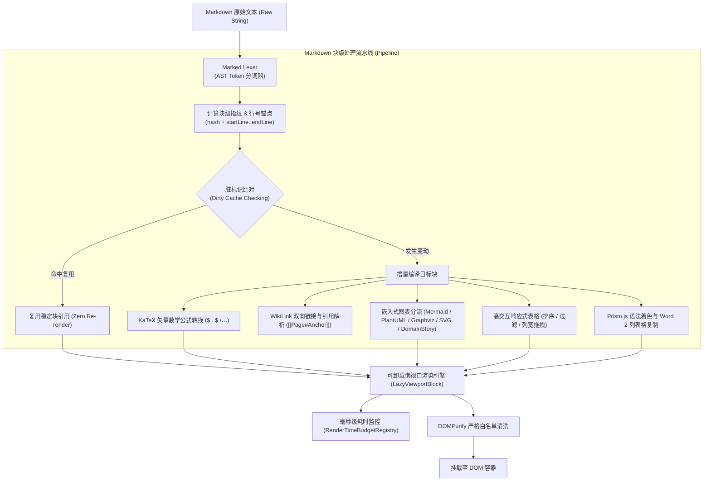
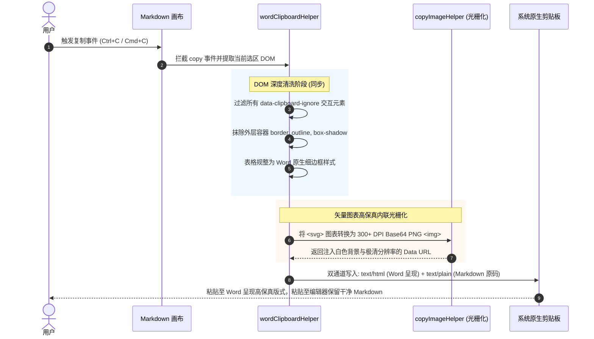

# OmniView Markdown 高性能解析与渲染流水线设计规范 (Markdown Pipeline Specification)

> **文档标识:** `docs/design/markdown-pipeline.md`  
> **所属子系统:** `src/features/viewers/components/drivers/MarkdownViewer.tsx` 及关联 Hook/Lib  
> **标准状态:** 现行核心架构规范

---

## 1. 架构总览与流水线阶段

OmniView Markdown 引擎并非简单的纯 HTML 转换器，而是面向企业级架构文档、学术论文与超长技术规格书设计的**块级虚拟化与增量响应式渲染管道**。



---

## 2. 块级指纹与增量脏标记复用机制 (Incremental Diffing)

为解决长文档（10,000+ 行）因微小按键或划词导致全篇整树卡顿的问题，系统引入 AST 块指纹机制：

1. **唯一块 ID 生成**: 结合块类型、起始行、终止行及文本内容的哈希计算唯一指纹：
   $$\text{BlockFingerprint} = \text{hash}(\text{type} + \text{startLine} + \text{endLine} + \text{rawText})$$
2. **块级引用复用**: 在 React 渲染树中，未发生变更的静态文本段落、高开销图表或表格直接复用上一轮的 React Element 引用，彻底阻断无效的子组件生命周期更新；
3. **行号精确锚定**: 每个 Token 均携带准确的 `startLine` 与 `endLine`，支持双向交互：
   - 预览区双击/选中触发 `onOpenSourceAtLine(startLine)`；
   - 宿主编辑器光标变动触发滚动监听（`useScrollHeadingSpy`）并在大纲树实时高亮当前章节。

---

## 3. 性能预算与慢块监控体系 (`renderTimeBudget.ts`)

为了对重型图表（如含数百个节点的 Mermaid 流程图或庞大 Graphviz DOT 状态机）保持可观测性与系统韧性，引擎内置了实时毫秒级性能监控：

```typescript
export class RenderTimeBudgetRegistry {
  /** 默认单块渲染耗时门限 (800ms) */
  private defaultBudgetMs = 800;
  
  /** 记录单块实际耗时 */
  recordTime(blockId: string, type: string, durationMs: number, startLine?: number, endLine?: number): void;
  
  /** 判断指定行或块是否超时，用于在大纲展示慢块警告徽章 */
  isLineSlow(line: number): boolean;
}
```

- **慢块告警徽章**: 当某个复杂渲染块耗时超过 800ms 时，大纲树中对应章节自动打上黄色性能警示图标，提示作者优化图表结构；
- **异步卸载保护**: 结合 `LazyViewportBlock`，当超长文档中的重型图表滚出视口超过 2 屏时，自动卸载底层渲染实例，将内存归还给浏览器/VS Code Webview，滚动回视口时依据 `blockHeightCache` 高度记忆池瞬间恢复，确保零布局抖动 (Zero Cumulative Layout Shift)。

---

## 4. Word / WPS 剪贴板富文本高保真清洗流水线 (`wordClipboardHelper.ts`)

在企业研发环境中，开发者经常需要将 Markdown 文档（含表格、图表、高亮代码）复制到 Microsoft Word 或 WPS 中汇报。传统复制存在三大行业痛点：
1. 外部图表复制进 Word 出现红叉或空白；
2. Tailwind CSS 类名与多重包装层导致 Word 中充斥多余边框与黑框；
3. 复制时误将悬浮工具条、拖拽手柄、排序按钮等交互 UI 一并复制。

OmniView 通过独创的**同步多通道剪贴板清洗流水线**彻底解决上述痛点：



---

## 5. A4 2.0 工业级出版打印与排版引擎

支持将 Markdown 或 Typst 文档一键编译为工业级 A4 纸张排版：
- **精确厘米级版心**: 严格遵循国家与国际标准 A4 规格（210mm × 297mm，标准边距 25.4mm）；
- **动态跨页断页算法**: 智能探测段落与代码块高度，避免表格或图表在中间被生硬截断（`break-inside: avoid`）；
- **页眉页脚与动态页码**: 自动注入文档标题、生成时间与 `第 X 页 / 共 Y 页` 打印标线。

---

## 6. 全图表与图片双击全屏与交互手势分流体系 (Double-Click Lightbox & Event Interception)

为了给长文档阅读者提供无缝放大的图表检视体验，并彻底消除双击放大图表时误触源码跳转导致宿主编辑器抢焦的缺陷，系统设计了统一的**图表全屏双击协议与容器分流机制**：

### 6.1 统一图表双击协议与视觉反馈
1. **全图表类型覆盖**：Mermaid、PlantUML、Graphviz DOT、SVG、Markmap、Excalidraw、DomainStory 及 KaTeX 数学公式均在视觉预览视图中接入统一的双击处理器；
2. **矢量无损捕捉 (Markmap SVG 序列化)**：对于 Markmap 等动态 DOM 渲染脑图，双击时通过 `XMLSerializer` 提取当前激活的 `<svg>` 节点，以矢量格式传入 `LightboxModal`，呈现无极缩放效果；
3. **光标手势暗示**：图表与可放大图片悬停时自动显示 `cursor-zoom-in` 并附带本地化全屏提示。

### 6.2 容器双击事件拦截与源码跳转隔离
在 `useMarkdownScrollSync.ts` 的 `handleContainerDblClick` 监听器中实行分层防御：
1. **普通图片 (``)**：自动遍历容器内所有可见图片组装全屏画廊，并调用 `stopPropagation()`；
2. **独立内联 SVG**：直接打开矢量灯箱并阻止冒泡；
3. **图表与画布区域拦截**：显式匹配 `.markdown-diagram, .diagram-block, .diagram-canvas, .markdown-diagram-svg-canvas, canvas`，阻止冒泡到外层 `[data-source-line]` 元素，严格禁止触发 `onOpenSourceAtLine`；
4. **源码定位开关生效**：仅在普通文本段落且用户显式开启 `enableDoubleClickEdit` 时才激活 VS Code 源码高亮跳转。

### 6.3 基于光标所在位置的无级缩放引擎 (Focal Point Zoom Engine — `focalZoom.ts`)
全屏灯箱 `LightboxModal` 引入物理级光标锚点缩放引擎：
1. **几何不变性公式 (Focal Invariance)**：
   $$\text{pan}_{\text{new}} = \text{offset} - (\text{offset} - \text{pan}_{\text{old}}) \cdot \frac{\text{zoom}_{\text{new}}}{\text{zoom}_{\text{old}}}$$
   其中 $\text{offset} = \text{cursor} - \text{center}$ 为光标相对于视口中心的偏移。缩放前后光标所指图元内容在屏幕上处于绝对同一物理像素，彻底消除缩放向屏幕中心漂移的体验缺陷；
2. **多模态缩放因子自适应 (`calculateWheelFactor`)**：
   - **触控板双指捏合 (`ctrlKey = true`)**：采用连续指数平滑因子 $\exp(-\Delta y \cdot 0.01)$；
   - **传统滚轮单步滚动**：采用 $1.15$ / $0.87$ 对数平衡阶梯；
3. **60 FPS 稳帧与零延迟响应**：
   - 滚轮缩放与鼠标拖拽平移期间，自动切换 `transition: none`，杜绝 CSS 补间与密集滚轮事件冲突导致的跳帧与拖影；
   - 工具栏按键或 1:1 / 适屏重置时自动恢复 `transform 0.15s` 缓动；
4. **全触点锚定**：鼠标滚轮缩放、触控板手势、键盘快捷键 `+`/`-`、工具栏缩放按钮以及画布双击放大均 100% 绑定至当前光标物理坐标。

---

## 7. 预览窗口块级完整生命周期原地 CRUD 引擎 (In-place Block CRUD Engine)

为解决传统 Markdown 编辑必须脱离预览画面在长篇纯源码中艰难搜寻段落的割裂体验，OmniView 引入**块级原地生命周期 CRUD 引擎**：

### 7.1 渐进式块级悬浮动作胶囊 (`MarkdownBlockActionBar`)
- 在每个可编辑 AST 块右上角提供极简悬浮动作胶囊：`[ ✏️ 局部编辑 | ➕ 下方插入 | 📑 克隆块 | ↑ 上移 | ↓ 下移 | 🗑️ 删除 ]`；
- **智能正文右侧贴合 (`computeBlockContentRightOffset`)**：当短标题、段落、窄表或图件未铺满行宽时，悬浮胶囊自动测量内容实际渲染边界并贴齐右缘，不遮挡正文；
- **Lexer 纯净相邻遍历**: 过滤 `marked.lexer` 产生的空 Token（如孤立 space），确保上下移动 100% 精准交换真实相邻块。

### 7.2 专注微编辑与防误触双保险 (`MarkdownFocusedBlockEditor` & `MarkdownBlockUndoToast`)
- **双态微编辑器**: 支持「纯源码快速输入 / 左右实时微预览」，内联插入与克隆快捷操作；
- **防误触双重保护**:
  1. 行内二次确认：点击删除激活确认态；
  2. 底部 6 秒非阻塞一键撤销浮条 (`Undo Toast`)：误删后瞬间回滚源码，无需打断式弹出模态框；
- **纯函数空行智能守恒 (`markdownBlockEditor.ts`)**: 无论删除首块、中间块还是末尾块，算法均自动归一化消除双空行或悬挂空行。

---

## 8. GitHub Alert 思想扩展图片语义容器与管道修饰符 (Image Containers & Modifiers)

### 8.1 三大图片语义容器
1. **多图画廊网格 (`> [!GALLERY:2~6]` / `[!IMAGES]`)**: 支持 1~6 列响应式容器网格，自动提取 `alt` 生成底部居中图注，支持折叠手风琴；
2. **标准技术图件框 (`> [!FIGURE]` / `[!FIG]`)**: 居中语义化 `<figure>` 舞台与 `<figcaption>` 自动编号图注；
3. **图文并排分栏 (`> [!MEDIA]` / `[!MEDIA:RIGHT]`)**: 5:7 黄金比例左图右文或左文右图并排呈现，窄屏自动折行。

### 8.2 管道修饰符与主题感知
- **尺寸与排版修饰符**: 语法如 ``；
- **透明底反差衬板**: `|bg-light`、`|bg-dark`、`|bg-checker`，解决深色主题下透明背景图表“隐形”的顽疾；
- **GitHub 模式感知**: `#gh-dark-mode-only` 与 `#gh-light-mode-only` 联动全量 14 套主题自动切换图片。

---

## 9. AI 无标记内联修改协同识别与三态对比控制栏 (AI Diff Engine & Tri-State Toolbar)

为适应 AI 辅助编程与多人协作中常见的代码/文档审查场景，OmniView 在 Markdown 渲染流水线中前置挂载了轻量级差异感知引擎：

### 9.1 差异分词与启发式比对核心 (`markdownDiffEngine.ts`)
- **多模态修改标记自动解析**:
  - 行内差异标记：识别 `~~删除内容~~` 与 `<mark>新增内容</mark>` / `++新增内容++`；
  - 行级 Diff 语法块：解析 ````diff` 代码块中的 `+` 增加行与 `-` 删除行；
  - 零侵入纯函数管道：输入原始 Markdown 文本，输出包含统计元数据 (`additions`, `deletions`, `modifications`) 与三态 AST 投影；
- **零外部依赖与微秒级响应**: 算法基于高效双指针字符扫描，在处理数万字长文时耗时控制在 5ms 以内，完全不阻塞主渲染帧。

### 9.2 吸顶三态对比控制栏 (`MarkdownDiffToolbar`)
当检测到文档包含修改标记时，预览窗口顶部自动唤出半透明毛玻璃吸顶控制栏，提供三态无缝切换：
1. **最终修改后视图 (Result)**: 自动剥除所有删除内容，呈现变更应用后的纯净最新文档版式；
2. **原始修改前视图 (Original)**: 自动剥除所有新增与替换内容，还原修改前的初始历史全貌；
3. **内联对比视图 (Inline Diff)**: 红色删除线背景标注废弃内容，绿色高亮底色标注新增内容，直观对照修改细节；
4. **一键采纳与放弃**: 支持一键将“修改后”纯净文本直接回写源文件或复制到剪贴板。

---

## 10. 源码编辑光标像素级坐标定位与智能悬浮快速插入体系 (Caret Coordinates & Quick Inserter)

在 Markdown 源码编辑模式（分屏预览或全源码视图）下，如何让辅助工具栏如影随形贴近用户打字位置，是提升编辑心流体验的关键：

### 10.1 镜像 DOM 像素级光标定位核心 (`getCaretCoordinates.ts`)
- **彻底杜绝粗暴固定与线性估算**: 传统编辑器常将快捷栏固定在视口最右侧，或根据物理 `\n` 换行数乘以固定行高。这种算法在遇到长文本自动折行 (Word Wrap)、不同行高内联公式或缩进列表时会发生严重的像素脱节；
- **不可见镜像容器 (Mirror Div) 计算模型**:
  ```mermaid
  flowchart LR
      TA["Textarea 活跃输入框"] --> Clone["复制计算样式 (ComputedStyle)<br/>padding, border, font-family, line-height, wrap"]
      Clone --> Mirror["不可见镜像 DOM 容器 (Mirror Div)"]
      TA --> Substr["截取当前输入位置文本 (0 ~ selectionStart)"]
      Substr --> Mirror
      Mirror --> Marker["末尾插入测量标记 <span>|</span>"]
      Marker --> Measure["marker.getBoundingClientRect()"]
      Measure --> Result["输出精准 (caretLeft, caretTop) 绝对坐标"]
  ```
- **实时同步与性能预算**: 仅在光标移动 (`onSelect`)、按键抬起 (`onKeyUp`) 与滚动 (`onScroll`) 时以 `requestAnimationFrame` 防抖计算，单次测量控制在 0.3ms 极速水准。

### 10.2 智能跟随与自适应停靠 (`MarkdownQuickInserter`)
- **紧密贴合光标字符**: 悬浮快速插入胶囊默认吸附在光标字符右侧 `10px` 处，打字走到哪，工具栏跟到哪；
- **视口右边缘碰撞避让**: 当光标靠近文本框最右边界时，自动切换为停靠在光标左侧，永不出界或被侧边栏裁剪；
- **丰富工具与组件模板生态**:
  - **GitHub Alert 5 大标准框**: 一键插入 `[!NOTE]`、`[!TIP]`、`[!IMPORTANT]`、`[!WARNING]`、`[!CAUTION]`；
  - **交互式排版组件**: 一键插入 `[!TABS]` 多标签、`[!STEPS]` 步骤条、`[!COMPARE]` 方案对比、`[!TIMELINE]` 时间线；
  - **图表与公式**: 一键插入 Mermaid 流程图/时序图、PlantUML 架构图、SVG 矢量画布与 KaTeX 独立数学公式；
  - **排版结构**: 一键插入 H1~H3 标题、待办复选框、3×3 数据表格、代码块与分割线；
- **智能插入调度与历史撤销**:
  - 当前行为纯空行时，直接就地替换；
  - 当前有选中文本时，将组件容器自动包裹到所选内容外侧；
  - 当前行有文本且未选中时，自动在下方空行新建插入，光标瞬间就位；
  - 完整接入原生 Undo/Redo 历史栈，支持 `Ctrl+Z` / `Cmd+Z` 瞬时撤销。

---

## 11. DDD 领域驱动设计 5 大视图矩阵与 14 大渲染主题深度融合

### 11.1 5 大核心业务视图建模
OmniView 将复杂业务架构规范转化为 5 种统一的高级视图矩阵：
1. **业务故事图 (Business Domain Story)**: 呈现 Actor、Work Object 与操作行为链路；
2. **事件风暴图 (Event Storming Canvas)**: 领域事件 (Domain Events)、命令 (Commands) 与聚合根便利贴板；
3. **领域全景图 (Domain Landscape)**: 核心子域、通用子域与支撑子域的分区全景映射；
4. **限界上下文映射 (Bounded Context Map)**: 上下游依赖 (Upstream/Downstream)、防腐层 (ACL) 与合作关系拓扑；
5. **聚合实体模型 (Aggregate Entity Model)**: 实体、值对象与聚合根的不可变状态变迁图。

### 11.2 14 大渲染主题的统一语义令牌驱动
系统预置 14 套现代化渲染主题（VS Code 原生、GitHub 极客、Catppuccin 莫兰迪、Tokyo Night 霓虹夜、Notion 极简、深色极夜、明亮象牙、Nord 极地、Dracula 吸血鬼、Forest 森系、Solarized 柔和、复古牛皮纸、午夜深蓝、赛博朋克）。所有 Markdown 扩展组件、DDD 业务卡片与嵌入式图表均严格依托 `--ov-*` 语义设计令牌动态重绘，实现无缝暗黑/明亮无感切换。


