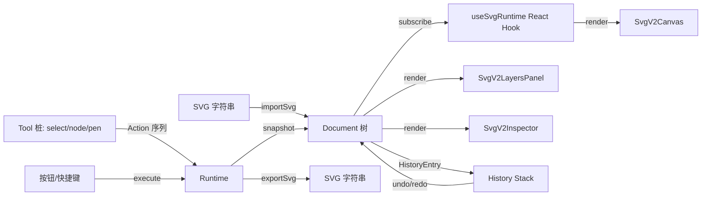

# OmniView SVG v2 编辑引擎设计规范 (SVG Edit Engine v2 Specification)

> **文档标识**: `docs/design/svg-v2-editor.md`
> **所属子系统**: `src/features/viewers/components/drivers/svg/`（v2 部分）
> **关联 ADR**: [ADR-0001 SVG 编辑引擎 v2 — 引入文档模型与命令管线](../adr/0001-svg-edit-engine-v2-document-model.md)
> **标准状态**: 已交付（v1 与 v2 双轨运行；用户通过 `omniview.svg.engine` 切换）

---

## 1. 架构总览

v2 引擎采用「不可变文档模型 + 命令管线 + Tool 状态机」三段式架构，参考 VectorCraft `crates/doc`、`crates/tools`、`crates/engine`：



## 2. 核心数据结构

### 2.1 Document（不可变）

```text
Document
├── canvas: { width, height, unit, viewBox }
├── layers: NodeId[]                    # z-order
├── nodes: Map<NodeId, Node>            # 全量节点
├── nextNodeId: number                  # ID 分配计数器
├── metadata: Record<string, string>
└── _internal: { revision }
```

**结构共享保证**：`updateNode(doc, id, fn)` 仅克隆变化的 entry，其他节点引用保持 === 相等；undo 几乎零成本。

### 2.2 Node 种类

| Kind | 说明 | 关键字段 |
|---|---|---|
| `Layer` | 顶层图层（必有 name/colorTag/visible/locked） | children |
| `Group` | 编组容器 | children + appearance |
| `Path` | 全部几何图元归一化（含 rect/circle/line/polyline/polygon） | geometry + appearance + primitiveHint |
| `Text` | 文本（P1 阶段只读） | text + appearance |
| `Image` | 图片（P1 阶段只读） | href + width + height |
| `Use` | 符号引用（P1 阶段只读） | symbolId |

### 2.3 PathGeometry

```text
PathGeometry
└── subPaths: SubPath[]
    └── SubPath
        ├── anchors: Anchor[]    # M/L/C/Q/A/Z 解码后的控制点
        └── closed: boolean

Anchor
├── point: Vec2
├── handleIn / handleOut: Vec2 | null
└── kind: 'corner' | 'smooth' | 'symmetric'
```

### 2.4 Selection

```text
Selection
├── nodeIds: NodeId[]      # 多选集合
└── primaryId: NodeId|null # 主选中（panel 高亮）
```

## 3. 命令管线 (Commands)

### 3.1 命令注册表

`core/commands/registry.ts` 维护所有命令的 `(id, title, undoLabel, params[], handler)` 描述。共 **38 条** 标准命令：

| 命名空间 | 命令 | 用途 |
|---|---|---|
| `path.*` | `set`, `insertAnchor`, `deleteAnchor`, `updateAnchor`, `convertLineStyle`, `reverseAnchors`, `close` | 路径几何编辑（含直角走线风格切换、顶点反向与幽灵中点折点插入） |
| `object.*` | `createPath`, `createText`, `move`, `scale`, `rotate`, `transform`, `duplicate`, `group`, `ungroup`, `reorder`, `delete`, `setName`, `setVisible`, `setLocked`, `align`, `distribute` | 图元创建与变换 + 结构 + 显隐锁定 + 对齐分布（`align` 支持 selection/canvas 双基准；`distribute` 首尾不动等距；`reorder`/`layer.reorder` 支持 `toIndex` 供拖拽排序） |
| `paint.*` | `setFill`, `setStroke`, `setOpacity`, `setColor` | 外观与透明度 |
| `layer.*` | `add`, `remove`, `rename`, `setVisibility`, `setLock`, `reorder` | 图层操作 |
| `select.*` | `box`, `set`, `all`, `clear` | 选择 |
| `history.*` | `undo`, `redo` | 撤销栈 |
| `tool.*` | `setActive` | 工具切换 |

### 3.2 命令执行模式

每条命令是纯函数 `(doc, sel, params) → CommandResult`：

```ts
type CommandResult =
  | { ok: true; doc; selection; warnings? }
  | { ok: false; error: { kind, commandId, message } };
```

Runtime 调度：
- **Exec**（单步命令）→ 直接落地为 1 条 HistoryEntry；
- **Begin / Preview / Commit**（手势交互）→ Begin 时 snapshot 文档；Preview 在 snapshot 上反复重算；Commit 落地为 1 条 HistoryEntry。

## 4. Runtime 状态机

```text
┌─────────────────┐
│     Idle        │ ← default state
└─────────────────┘
   │ execute(Exec)
   ↓
┌─────────────────┐
│   Commit        │ ─→ write HistoryEntry ─→ back to Idle
└─────────────────┘

   │ execute(Begin)
   ↓
┌─────────────────┐
│  Previewing     │ ─→ execute(Preview) ─→ Previewing (replace prev)
   │
   ├── execute(Commit) ─→ write 1 HistoryEntry ─→ Idle
   └── execute(Cancel) ─→ restore snapshot ─→ Idle
```

## 5. React 集成

### 5.1 useSvgRuntime Hook

```ts
const {
  runtime, document, selection, activeToolId,
  canUndo, canRedo,
  execute, undo, redo, setActiveTool,
} = useSvgRuntime(initialContent);
```

- 内部通过 `runtime.subscribe(setSnapshot)` 订阅状态变化；
- 任何 doc/sel/tool/history 变更自动触发 React re-render。

### 5.2 顶层组件：SvgV2Studio

`SvgV2Studio.tsx` 三栏布局（编排外壳，2026-10 起按大组件阈值拆分；P0 起画布与输入独立成组件）：
- **左**：工具栏（select / node / pen + Undo/Redo + 新建图层）；
- **中**：`SvgV2Canvas.tsx`（递归渲染 Layer > Group > Path/Text/Image/Use 树，Group 以 `<g>` 嵌套；`<defs>` 原始片段经 DOMPurify 后内联，渐变/图案引用不断链；渲染选中包围盒与 `runtime.overlay()` 框选虚线框）；
- **右**：`SvgV2LayersPanel` + `SvgV2Inspector` + 引擎切换器。

**`useSvgV2PointerInput.ts`（P0 交互接通）— 画布输入 Hook**：
- pointer：`down`（`setPointerCapture`）→ `drag`（按键拖动）/ `move` → `up` / `cancel`，映射为 `runtime.dispatchPointer`；
- 坐标反变换优先 `getScreenCTM().inverse()`，回退纯函数 `clientToCanvasPoint`（letterbox 数学）；
- 键盘：Ctrl/Cmd+Z/Shift+Z/Y 撤销重做、Ctrl/Cmd+A 全选；工具键（Enter/Escape/Backspace/Delete/方向键/Tab/Home/End）映射 `ToolKey` 下发；输入控件内不拦截。

**加载/回写时序（P0 数据安全，`core/runtime/exportSync.ts` 纯函数裁决）**：
- 加载完成前（`loaded=false`）绝不回写；加载完成瞬间记「已导出基线」不回写（格式化差异不打脏宿主）；
- 仅文档真实变更（新 Document 对象）→ 导出 → `onContentChange`；`content === lastExported`（echo）不重载，外部真实变更才重载；
- 备份 `decideBackup` 仅在首次真实编辑触发一次（`backupOnceRef`）。

**`SvgV2LayersPanel`（`SvgV2LayersPanel.tsx`）— 图层树面板**：
- `flattenLayerTree` 递归展示 Layer/Group 编组树（深度缩进、展开/折叠、子项计数）；
- HTML5 拖拽排序：拖拽推导走 `planReorderDrop` 纯函数 → `layer.reorder(toIndex)`（层间）/ `object.reorder(toIndex)`（同层图元）；跨层拖拽与类型不匹配返回 null（P1 边界）；
- 双击行内重命名（Layer → `layer.rename`；Group/Path → `object.setName`），Enter/blur 提交、Escape 取消；
- 行级显隐（`layer.setVisibility` / `object.setVisible`）与锁定（`layer.setLock` / `object.setLocked`）；
- 落点视觉提示（行上/下半 2px accent 边框）、拖拽源半透明。

**`SvgV2Inspector`（`SvgV2Inspector.tsx`）— 属性检视器**：
- 单选：填充色 + 包围盒/位置/名称 + 删除；
- 多选（≥2）：6 向对齐按钮（选区/画布基准切换）+ 批量填充 + 批量透明度 + 批量删除；
- 多选（≥3）：水平/垂直等距分布按钮；
- 对齐/分布/批量样式全部经命令管线落地，天然支持撤销。

## 6. 持久化与备份

### 6.1 SVG 单一持久化

- import：`fallbackDomParse(svg)` → Document；
- export：`documentToSvgString(doc, opts)` → SVG 字符串（pretty / minimizeIds / omitHiddenLayers）；
- 双轨：浏览器走 DOMParser；Node.js（测试用）走正则 fallback。

### 6.2 usvg-wasm 路径（M1 阶段就绪）

- 路径：`scripts/build-usvg-wasm.mjs` 检测 Rust toolchain；
- toolchain 缺失时自动回退 DOMParser；
- 产物落地 `public/usvg-wasm/`，Vite 静态服务，Worker 懒加载。

### 6.3 自动备份

- 切到 v2 引擎后，**首次修改**时把原 SVG 内容（含 `[omniview-v2-engine]` 标记）落 `*.bak.svg`；
- 仅首次切换写备份，后续编辑不再落盘；
- 备份由 `core/backup.ts` 提供 writeBackup 接口（VS Code webview 端通过 postMessage 桥接）。

## 7. Feature Flag

```text
omniview.svg.engine = 'v1' | 'v2'    # 默认 'v1'
```

- `core/featureFlag.ts` 提供 getSvgEngineFlag / setSvgEngineFlag；
- `SvgViewer.tsx` 入口检查 flag，命中 v2 走 `SvgV2Studio`；否则走原 v1 路径；
- v2 引擎 UI 右下角引擎切换器可实时切换（reload 页面生效）。

## 8. 测试覆盖（10 大专项目录 / 全过）

| 测试套件 | 覆盖核心能力 |
|---|---|
| `test-svg-v2-core-model.mjs` | Document 工厂 / 增删 / 结构共享 / Selection / 几何变换 / path d 编解码 / fuzzing |
| `test-svg-v2-runtime-commands.mjs` | Runtime 基础 / execute / Action 序列 / undo+redo / 编组解组 / 删除 / 错误路径 / Tool dispatch / export / fuzzing |
| `test-svg-v2-e2e.mjs` | SVG round-trip / 编辑往返 / 撤销栈 / 异步边界 / 8 样例 fuzzing / 综合工作流 / Feature Flag / Backup |
| `test-svg-v2-wheel-zoom-fix.mjs` | 滚轮缩放防误触契约：属性面板/批量面板/状态栏/UI 控件内的 wheel 不触发画布 zoom，画布上 wheel 正常缩放 |
| `test-svg-v2-layers-batch.mjs` | 几何纯函数（transformRect/nodeBBox/alignDelta/distributeOffsets）/ object.align 双基准 / object.distribute / setVisible/setLocked / 图层树 flatten+折叠 / 拖拽推导 planReorderDrop / toIndex 端到端 / 编组子节点去重 |
| `test-svg-v2-p0-fixes.mjs` | P0 回归：usvgTreeToDocument 结构（text/image/use/渐变/visibility/transform）/ 导出三类型 + defs 回插 / exportSync 决策真值矩阵 / clientToCanvasPoint letterbox / select 手势历史 / Escape 取消 / overlay / Image bbox 命中 |
| `test-svg-v2-tools-shapes.mjs` | 矩形/椭圆/直线/箭头拖拽直觉起绘 / 约束比例 Shift 与中心 Alt / 双端点线条与箭头控制圆柄 / 幽灵中点拖拽即折 / 一键直角走线风格切换 (`path.convertLineStyle`) / 顶点反向 |
| `test-svg-v2-advanced-interactions.mjs` | 无头交互测试：多工具状态机切换 / 选区生命周期 / 批量移动协同 / 极端拖拽边界防御 |
| `test-svg-v2-transform-align.mjs` | 绝对世界变换矩阵 / 多层嵌套编组对齐分布 / 选区与画布双基准校准 |
| `test-svg-v2-viewport.mjs` | 视口平移缩放变换 / 光标锚点对齐 (Focal Zoom) / 边界限制 |

另：`test-svg-utils.mjs` 第 22 组覆盖 v1 A/S/T 路径保真（解析-序列化 round-trip、弧段插入禁用、混合路径段数守恒）。

## 9. 已知边界与未来工作

### 9.1 P1 当前未覆盖

- 文本 `<text>` 内容编辑（P0 起可渲染/选中/移动/删除，富文本编辑为后续规划）
- 图片 `<image>` 内容替换（P0 起可渲染/选中/移动/删除）
- Symbol / Use 编辑（P0 起可渲染/选中/移动/删除）
- Pattern / Mask / ClipPath 烘焙（`<defs>` 原始片段经 DOMPurify 原样透传，浏览器渲染层处理）
- 滤镜（filter）编辑（只读）
- 图元跨层拖拽（`planReorderDrop` 跨层返回 null，仅支持层间拖拽与同层内图元拖拽）
- 分布仅支持选区基准（首尾不动等距；画布基准分布为后续规划）

### 9.2 路线规划与落地现状

| 阶段 | 内容 | 落地状态 |
|---|---|---|
| **v1.3.16** | 鼠标拖拽直觉起绘（矩形/椭圆/直线/箭头）；双端点箭头控制；直线向折线演化（幽灵中点折叠手柄 + 一键直角走线切换） | ✅ **已交付** |
| **P2** | 多边形/星形/弧/螺旋/网格；渐变面板；外观面板 | 规划中 |
| **P3** | 路径查找器（布尔运算）；画笔；宽度工具；实时效果 | 规划中 |
| **远期** | MCP 命令表面；多格式导入导出（PDF/AI/EPS） | 规划中 |

## 10. 验收清单（ADR §7 对齐）

- [x] `npm run lint:codex` 0 错误
- [x] `npm run check:structure` 0 反向依赖、0 循环
- [x] `npm run check:doc-code-consistency` 通过
- [x] `npm run check:react-governance` 通过
- [x] `npm run lint` (`tsc --noEmit`) 0 错误
- [x] `npm run test` 全过（10 大 SVG v2 专项测试套件 + 全量 85 套件通过）
- [x] `npm run build:plugin` 0 错误
- [x] `npm run verify` 综合门禁全绿
- [x] Round-trip：编辑 → export → import 关键图元保持一致
- [x] 撤销 100 步 + 重做 100 步结构共享保持稳定
- [x] Feature Flag 默认 v1，可切到 v2 实验引擎
- [x] 8 个真实 SVG 样例（含 rect/circle/line/path/g/text/stroke）全过 fuzzing
- [x] 异步边界：连续 10 次 loadFromSvg + 失败注入均不破坏 runtime
- [x] 备份策略：首次切到 v2 时落 .bak.svg