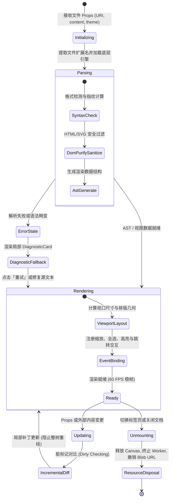
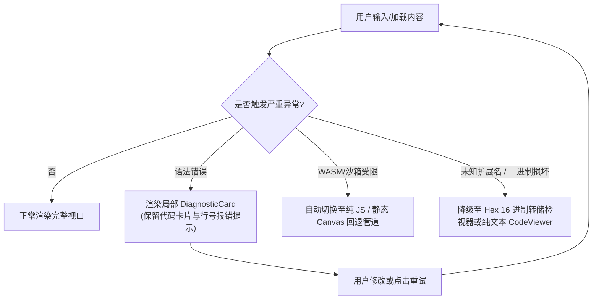
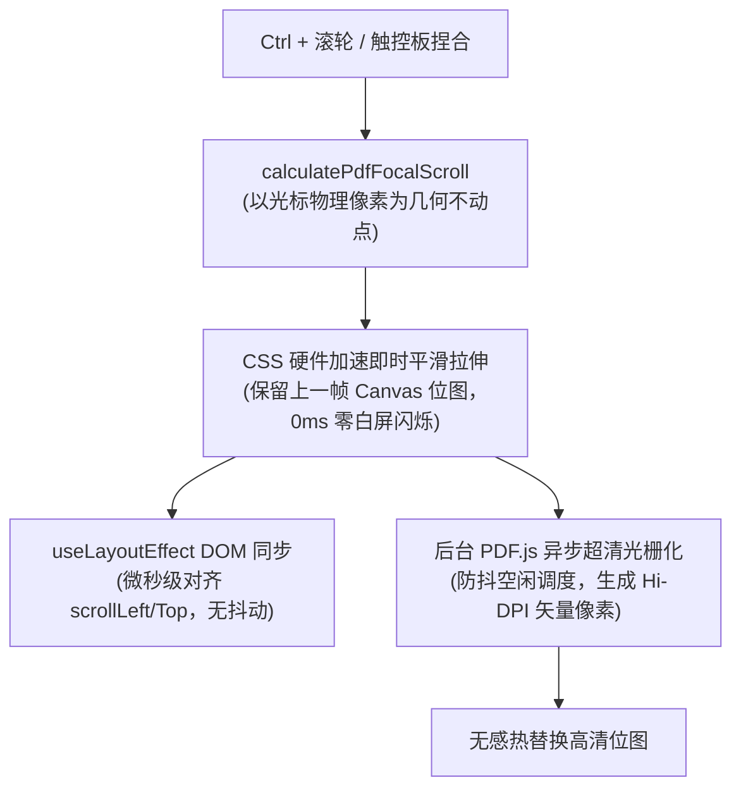

# OmniView 文件格式驱动架构与设计规范 (Viewer Drivers Design Specification)

> **文档标识:** `docs/design/viewer-drivers.md`  
> **所属子系统:** `src/features/viewers/`  
> **标准状态:** 现行核心架构规范

---

## 1. 驱动矩阵全景概览

OmniView 采用轻量化、按需加载的微内核驱动架构。整个系统由统一的驱动调度总控（`ViewerRenderer.tsx` 与 `driverRouting.ts`）统一负责文件类型识别、扩展名感知、MIME 嗅探与降级兜底。

### 1.1 驱动能力支持矩阵

| 序号 | 驱动模块名称 | 支持文件扩展名 | 核心底层内核 / 技术栈 | 核心交互特性 | 导出与联动能力 |
| :--- | :--- | :--- | :--- | :--- | :--- |
| **01** | `MarkdownViewer` | `.md`, `.markdown` | Marked Lexer AST + KaTeX + Prism.js | 块级虚拟化、慢块预算、双向行号锚定、大纲 Heading Spy | Word/WPS 原生双列表格复制、A4 出版打印 |
| **02** | `PlantUmlViewer` | `.puml`, `.plantuml`, `.iuml` | PlantUML Server API / 本地离线引擎 | 双栏实时编辑/预览、暗黑/明亮高对比度模式 | 300+ DPI SVG / PNG 导出、复制图像 |
| **03** | `SvgViewer` | `.svg` | SVG v2 不可变文档模型 + 8 核心矢量工具 + SVGO | SVG Studio v2 矢量工作台、鼠标拖拽直觉起绘、双端点箭头、幽灵中点折线演化、直角走线转换 | SVGO 压缩、React JSX / Vue 3 组件导出、无损 SVG |
| **04** | `PdfViewer` | `.pdf` | Mozilla PDF.js v4+ (Canvas 硬件加速) | Ctrl+滚轮光标锚定缩放、零白屏闪烁拉伸、抓手漫游 (Space+Drag/鼠标中键)、缩放预设菜单、中央 HUD 胶囊、多页连续/单页/双页排版 | Markdown 读书笔记导出、高清 PNG 快照、工业级系统打印 |
| **05** | `CsvViewer` | `.csv`, `.tsv` | RFC 4180 流式解析器 + 虚拟化表格 | 列宽自由拖拽、多列联合排序、字段统计画像 (Profiling) | CSV/TSV/JSON/Markdown 多格式互转导出 |
| **06** | `MermaidViewer` | `.mmd`, `.mermaid` | Mermaid.js v11+ (安全隔离渲染) | 流程图、时序图、甘特图、类图、状态机、Git 拓扑交互视口 | 300+ DPI PNG/SVG 导出、全屏沉浸检视 |
| **07** | `GraphvizViewer` | `.dot`, `.gv` | `@hpcc-js/wasm` (Web Worker / WASM) | 复杂有向图/无向图、多布局引擎 (dot/neato/fdp/circo) | 高清 SVG / PNG 导出、WASM 异常自愈 |
| **08** | `MindmapViewer` | `.markmap`, `.mm`, `.mindmap`, `.km` | Markmap 矢量树引擎 + D3.js 变换 | 双向分屏编辑、节点折叠展开、思维导图与大纲双向联动 | SVG/HTML 导出、平移缩放自适应 |
| **09** | `DomainStoryViewer`| `.ddd` | 统一 DDD 5 大视图模型与领域故事引擎 | Actor/Work Object 业务模型渲染、事件风暴便利贴、上下文映射、逐帧步进回放演播 | Polyglot SVG 导出、架构代码导出 |
| **10** | `ExcalidrawViewer` | `.excalidraw`, `.excalidraw.json` | `@excalidraw/excalidraw` 纯前端引擎 | 手绘白板工作室、自由图元绘制、图形/代码双向分屏 | 矢量 SVG/PNG 导出、模板库一键套用 |
| **11** | `NotebookViewer` | `.ipynb` (Jupyter v4) | 纯前端离线 Notebook 语法与流式解析 | Markdown 单元格富文本渲染、代码高亮、ANSI 错误栈 | HTML 报表导出、Markdown 转换导出 |
| **12** | `TypstViewer` | `.typ`, `.typst` | 纯端侧 AST 增量编译器 + A4 2.0 引擎 | 双向分屏编辑、KaTeX 公式混排、多版心切换、语法片段插入 | 工业级 A4 打印、无损 SVG / PDF 导出 |
| **13** | `StructuredDataViewer`| `.json`, `.yaml`, `.yml`, `.toml`, `.xml` | 统一结构化 AST 中间表示层 | 折叠树视图、导图全景投影、同构表格下钻、敏感配置脱敏 | 跨格式无损互转、美化压缩格式化 |
| **14** | `DocxViewer` | `.docx` | OOXML 标准解包 + `docx-preview` | Word 高保真拟真排版、50%~200% 平滑缩放、复杂表格单元格合并 | 原生打印、夜间暗色对比度反转 |
| **15** | `PptxViewer` | `.pptx` | 纯离线 OOXML 形状与层级解析器 | 16:9 / 4:3 矢量自适应幻灯片演播、全屏沉浸放映、备注抽屉 | 缩略图大纲跳转、逐页快速放映 |
| **16** | `XlsxViewer` | `.xlsx`, `.xls` | 纯前端 OOXML 解析 + JSZip 离线流 | 多工作表 (Multi-Sheet Tabs)、公式/计算值检视、列特征画像 | CSV/JSON/Markdown 导出、迷你走势图 |
| **17** | `ImageViewer` | `.png`, `.jpg`, `.jpeg`, `.gif`, `.webp`, `.bmp`, `.ico` | Canvas 2D 硬件加速引擎 | 10%~3200% 极清矢量缩放、16x 放大镜十字取色、EXIF 透视 | 多色彩空间复制、图片格式无损转换 |
| **18** | `CodeViewer` | `.js`, `.ts`, `.py`, `.go`, `.rs`, `.java`, `.cpp`, `.css` 等 | Prism.js 语法解析管道 | 60+ 主流编程语言语法着色、行号高亮、代码折叠 | 原生纯净复制代码、Word 2 列表格复制 |
| **19** | `DockerfileViewer` | `Dockerfile`, `*.dockerfile` | OmniView Dockerfile Parser | 多阶段构建流水线 DAG、端口/环境/卷矩阵提取、非 root 安全体检 | 阶段拓扑可视化、源码分屏协同 |
| **20** | `ComposeViewer` | `docker-compose.yml`, `*.compose.yml` | OmniView Compose Topology Engine + Mermaid | 微服务依赖拓扑图、网络隔离与卷挂载图谱、敏感变量打码脱敏 | 拓扑图导出、端口冲突体检 |
| **21** | `K8sViewer` | `k8s/*.yaml`, `*.k8s.yaml` | OmniView K8s Gravity Engine | 多文档 YAML 自动切分、4 层云原生引力拓扑、Selector 自动连线 | 探针/断链体检诊断、资源概览 |
| **22** | `HtmlViewer` | `.html`, `.htm` | OmniView Native Web Sandbox Engine | 严格受控双层 iframe 沙箱、响应式设备仿真 (Desktop/Tablet/Mobile) | 纯本地实时分屏热重载、原生打印 |
| **23** | `EpubViewer` | `.epub` | 纯前端 EPUB 解包 + 流式排版引擎 | 双叶并排/单页流式/连续滚动三视图、3D 拟真翻书动效、阅读进度持久化 | 护眼主题切换、排版偏好记忆 |

---

## 2. 驱动生命周期与状态模型

每个 Viewer 驱动遵循标准的 React 19 组件生命周期契约：



---

## 3. 标准驱动接口契约 (Driver Props Interface)

所有 Viewer 驱动均统一实现标准的输入输出契约：

```typescript
export interface BaseDriverProps {
  /** 文件文本内容或二进制 ArrayBuffer / Uint8Array */
  content: string | Uint8Array;
  /** 文件完整物理名称（含扩展名，用于识别与导出） */
  fileName: string;
  /** 当前宿主主题模式 (true: dark / false: light) */
  isDarkTheme: boolean;
  /** 全局当前设计令牌主题 ID ('vs-dark' | 'vs-light' | 'github-dark' | 等) */
  theme?: string;
  /** 界面紧凑度密度模式 ('compact' | 'normal' | 'spacious') */
  density?: 'compact' | 'normal' | 'spacious';
  /** 当前用户语言环境 ('zh-CN' | 'en-US') */
  locale?: 'zh-CN' | 'en-US';
  /** 当用户在预览视口双击或点击大纲时，请求宿主在指定行号跳转并聚焦源码 */
  onOpenSourceAtLine?: (line: number) => void;
  /** 允许 Viewer 驱动请求向源文件保存回写（受只读与脏检查限制） */
  onContentChange?: (newContent: string) => void;
}
```

---

## 4. 容错隔离与降级决策树 (Error Boundary & Resilience)

为避免单个图表或局部异常击垮整个 VS Code 工作台，系统实施三级降级防御机制：



1. **局部错误边界 (`RenderErrorBoundary`)**：图表、公式、表格均被独立的 React 错误边界包裹，子树异常不向上传播；
2. **多布局/多引擎自愈**：例如 Graphviz 优先采用 Web Worker 异步管道；若在强隔离沙箱中受 CSP 限制导致 Worker 实例化失败，自动降级至主线程内存 WASM 同步调度；
3. **未知格式智能降级**：无法识别的文本格式回退至通用代码着色器；未知二进制格式提供安全十六进制检查与元数据信息。

---

## 5. SVG 交互式矢量工作台与双核渲染架构 (SVG Interactive Studio)

SVG Viewer 具备可视化画布、源码双向联动与现代矢量 Studio 双轨架构：

1. **v1 轻量检视与代码行反向映射**:
   - 当用户在代码编辑器行号或标签悬浮时，解析模块通过 `getLineToElementIndex` 快速推导对应的 DOM 图元索引，并在画布上渲染脉冲高亮框；
   - 点击画布图元激活属性检视抽屉，支持位置、颜色、描边、变换矩阵等属性的原生微调与源码同步。
2. **v2 现代矢量编辑引擎 (`SvgV2Studio`)**:
   - **不可变文档模型 (`Document`) 与结构共享**: 38 条标准命令管线，无限步 Undo/Redo 历史栈；
   - **8 大核心矢量工具**: 选择 (`select`)、锚点编辑 (`node`)、贝塞尔钢笔 (`pen`)、矩形 (`rect`)、椭圆 (`ellipse`)、直线 (`line`)、箭头 (`arrow`) 与文本 (`text`)；
   - **鼠标拖拽直觉起绘**: 拖拽实时渲染边框/骨架虚线预览 (`Preview`)，松开提交 (`Commit`)，支持 Shift 约束等比正方形/正圆/15° 步进射线角度，Alt 键中心对称起绘，原地误触单击自动取消；
   - **双端点箭头与骨架控制**: 独立箭头工具（快捷键 `W`）；选中线条/箭头自动呈现虚线轴线与两端点控制圆柄（屏蔽生硬 8 向矩形框），可单独拖拽端点微调并支持一键反向调向 (`ArrowLeftRight`)；
   - **直线向折线智能演化 (方案 3)**:
     - **幽灵中点折叠手柄 (Ghost Midpoints)**: 直线中点半透明虚线手柄直接拖拽即可拉出新折点转化为折线，双击折点或删除折点无损恢复为直线；
     - **常用直角走线风格一键转换 (`path.convertLineStyle`)**: 属性栏与悬浮 HUD 支持在「直线 ↔ Z形直角 ↔ V形直角 ↔ L形单折角」之间一键切换；
   - **全链路无损导出**: 支持 SVGO 极简优化、React JSX、Vue 3 模板与 Base64 Data URI 一键导出。

---

## 6. PDF 工业级全能阅读器与交互架构 (PDF Industrial-Grade Interactive Studio)

OmniView 采用 Mozilla PDF.js v4+ 真实光栅化内核，结合 React 19 并发渲染与 GPU 硬件加速技术，彻底解决传统 Webview 阅读 PDF 时的「滚轮缩放白屏闪烁」、「大倍率漫游困难」、「光标锚点跳动」三大体验顽疾：



1. **光标几何不变性无级缩放 (Focal Point Wheel Zoom)**:
   - 滚轮缩放时，纯函数 `calculatePdfFocalScroll` 依据当前光标在视口中的物理坐标，精确反算新缩放比下的目标 `scrollLeft` 与 `scrollTop`；
   - 结合 React `useLayoutEffect` 在浏览器 Paint 前同步写入 DOM，保证鼠标正下方的段落文字或图元永远稳锁，绝不产生视口跳动与视觉漂移；
2. **零白屏闪烁平滑拉伸过渡机制 (Zero-Flicker Canvas Layering)**:
   - 彻底废除旧版缩放时粗暴清空 `canvas.width = 0` 的缺陷设计；
   - 缩放过渡阶段依托 CSS `width: 100%; height: 100%` 让上帧位图充当硬件加速平滑占位，后台 PDF.js 线程以 Worker 完成高分辨率渲染后无缝交换像素缓冲，用户体验丝滑如 Google Chrome / Adobe Acrobat；
3. **抓手漫游模式与全场景平移 (Hand Pan Mode & Space+Drag)**:
   - 顶部工具栏提供「选择 (`select`)」与「抓手 (`hand`)」一键切换；
   - 支持主流设计工具标准的 **长按空格键 + 鼠标左键拖拽 (Space + Drag)** 与 **鼠标中键（滚轮按键）拖拽**，在 150%~500% 超宽缩放下随意漫游；
4. **缩放预设快捷下拉菜单与中央浮动 HUD 胶囊**:
   - 点击缩放百分比按钮，呼出 50%、75%、100% (实际大小)、125%、150%、200%、300%、400%、500% 常用预设，以及适合宽度 (W)、适合页面 (H)；
   - 滚轮缩放时屏幕底部正中央弹出毛玻璃 HUD 胶囊，带动态百分比与线性刻度条，900ms 自动平滑渐隐；
5. **深度提升点评估与后续演进路线 (Comprehensive Evaluation & Future Roadmap)**:
   - **全屏沉浸演示模式 (Presentation Mode)**: 专为技术分享与学术汇报设计，一键隐藏所有侧边栏与工具栏，提供激光笔小圆点与极简浮动切页器；
   - **实体书本对开模式的封面偏移 (Cover Page Spread Offset)**: 通常图书刊物第 1 页为独立封面，支持首页单独居中，第 2/3、4/5 页作为成对内页对开显示，还原实体书刊真实阅读习惯；
   - **缩略图侧栏拖拽重排与单页提取/导出 (Page Reordering & Split)**: 在左侧缩略图抽屉中支持拖拽调整页面物理顺序、单页删除或一键导出为独立单页 PDF；
   - **离线轻量 OCR 文本图层增强 (Scanned PDF OCR)**: 针对纯图片扫描件或无文字层的 PDF 文档，挂载端侧离线轻量 OCR 引擎补充生成可检索与选词的 TextLayer。

---

## 7. Office 纯离线三件套驱动架构 (Office Offline Suite Drivers)

OmniView 为桌面端办公文档提供零外部依赖、100% 本地沙箱离线解析与高保真呈现能力：

### 7.1 XlsxViewer 纯前端专业电子表格工作台
- **离线解包管道 (`xlsxEngine.ts`)**: 基于 Open Packaging Conventions (OOXML) 标准，纯端侧解压读取 `xl/workbook.xml`、`xl/worksheets/sheet*.xml` 与 `xl/sharedStrings.xml`，构建响应式内存工作簿模型；
- **多工作表毫秒级切换 (Multi-Sheet Tabs)**: 底部常驻工作表标签栏，点击平滑切换激活 Sheet，内存按需懒解析与缓存；
- **公式表达式与计算值自由切换**: 支持一键切换「显示计算结果」与「显示原始 Excel 公式 (`fx`)」，辅以数字列右对齐、日期与布尔值规范化；
- **字段画像透视分析 (Profiling)**: 一键激活列特征分析抽屉，即时推导各列有效率、缺失率、唯一值基数、均值与极值区间；
- **自研列宽自由拖拽与持久化 (`xlsxColumnWidthStorage.ts`)**:
  - 用户可鼠标拖拽表头右边缘自由调节列宽；
  - 依托 `localStorage` 细粒度记忆各文件、各工作表的自定义列宽配置，重新打开自动精准复原；
  - 表头动态计算吸顶偏移量 (`stickyTop`)，横向大表滚动时表头紧密固定，永不与工具栏发生视觉重叠；
- **多格式互转导出**: 支持将当前工作表秒级导出为标准 CSV、格式化 JSON 以及规范 Markdown 表格。

### 7.2 DocxViewer 纯前端 Word 高保真拟真工作台
- **离线渲染流水线 (`docxEngine.ts`)**: 依托 `docx-preview` 纯前端内核，直接在浏览器 DOM 解析 OOXML 样式表、段落属性、列表缩进与复杂嵌套表格；
- **A4 拟真版式与视口漫游**: 50%~200% 平滑缩放，支持暗黑模式对比度智能反转（文档底色反转与反差色文字映射，消除夜间刺眼感）；
- **动态大纲提取与目录树 (`DocxTocSidebar`)**: 自动遍历 DOM 解析 H1~H6 标题，支持双向平滑滚动定位与层级折叠；
- **全文检索高亮与跨节聚合 (`aggregateSearchMatchesByToc`)**: 检索关键词在页面中黄色高亮，并在左侧大纲树直观显示各章节匹配数量；
- **Word DOM 转 Markdown 导出 (`docxDomToMarkdown`)**: 一键将 Word 页面提取为清晰规范的 Markdown 文本并复制到剪贴板；
- **工业级系统打印桥接 (`requestPrintHtml`)**: 发起无损打印命令，调用系统打印机直接输出高精度纸质文档。

### 7.3 PptxViewer 矢量幻灯片只读演播工作台
- **离线形状与图元提取 (`pptxEngine.ts`)**: 解析幻灯片 XML，重构文本框、矢量几何形状、排版样式与多媒体图片；
- **自适应视口与沉浸放映**: 提供标准 16:9 与 4:3 比例自适应缩放，支持全屏沉浸演播模式 (`PresentationMode`) 与键盘 `PageUp`/`PageDown`/方向键切页；
- **缩略图大纲与演讲者备注抽屉**: 底部/左侧提供缩略图快速导航，支持展开演讲者专属备忘笔记抽屉；
- **零外部网络调用**: 杜绝将商业机密 PPT 上传至第三方转码服务器，确保安全合规。

---

## 8. 云原生三合一工作台与 HTML5 沙箱驱动架构 (Cloud-Native & Web Sandbox Drivers)

针对现代化容器化与云原生开发场景，OmniView 构建了原生的结构化分析与安全呈现工作台：

### 8.1 DockerfileViewer 镜像构建流水线工作台
- **多阶段构建流水线 DAG 图形化拓扑**: 自动解析 `FROM ... AS <stage>`，推导各阶段间的依赖关系并渲染为清晰的构建拓扑图；
- **容器资产三维矩阵提取**: 一键提取并归纳整份 Dockerfile 中的暴露端口 (`EXPOSE`)、环境变量 (`ENV`) 与持久化挂载卷 (`VOLUME`)；
- **非 root 安全基线体检**: 静态合规扫描末尾执行用户身份，若缺少 `USER` 指令或以 root 身份运行，即时弹出安全预警；
- **双栏分屏协同**: 左侧实时编辑指令，右侧动态更新构建阶段拓扑与体检报告。

### 8.2 ComposeViewer 微服务编排拓扑工作台
- **微服务依赖拓扑有向图**: 基于 `depends_on` 语法自动生成微服务启动顺序与网络连通有向图；
- **隔离网络与存储卷拓扑图谱**: 直观呈现各服务加入的桥接网络 (`networks`) 以及挂载的主机目录/数据卷 (`volumes`)；
- **敏感环境变量自动星号打码脱敏**: 自动识别包含 `PASSWORD`、`SECRET`、`KEY`、`TOKEN` 等敏感字段的环境变量，默认以 `••••••••` 打码，支持点击临时眼球解密；
- **端口冲突静态体检**: 自动检测多服务绑定相同主机端口的隐患，标红阻断部署故障。

### 8.3 K8sViewer Kubernetes 声明式架构引力拓扑工作台
- **多 YAML 文档流式智能切分**: 原生支持单文件内以 `---` 分割的数十个 K8s 资源清单，自动按命名空间与资源种类归类；
- **4 层云原生引力拓扑图**:
  - 第一层：入口网关与路由 (`Ingress`)；
  - 第二层：服务负载均衡 (`Service`)；
  - 第三层：核心工作负载 (`Deployment`, `StatefulSet`, `DaemonSet`, `Job`)；
  - 第四层：运行时实例与配置 (`Pod`, `ConfigMap`, `Secret`, `PVC`)；
- **Selector 与 Label 全自动反向拓扑推导**: 深度遍历各资源的标签选择器，全自动推导并渲染资源间的引力连线；
- **孤儿资源与断链健康体检**: 实时探测未关联到有效 Pod 的空 Service，以及引用了不存在 ConfigMap/Secret 的悬挂工作负载。

### 8.4 HtmlViewer 独立安全沙箱工作台
- **双层受控 iframe 沙箱**: 强制使用 `sandbox="allow-scripts"` 严格隔离环境，剥除 `allow-same-origin`，彻底隔绝访问 VS Code 宿主 API 与上层父窗口的能力；
- **响应式设备视口仿真器**: 提供桌面级 (1920×1080)、轻薄本 (1366×768)、平板 (768×1024)、手机移动端 (375×667) 一键切换，并支持横竖屏 90° 旋转与缩放适配；
- **纯端侧实时热重载**: 源码修改后 0 延迟局部刷新，支持纯本地 HTML 打印。

---

## 9. 专业架构建模与多图表驱动架构 (Diagram & Architecture Drivers)

### 9.1 PlantUmlViewer 14 大渲染主题深度融合
- 针对 PlantUML 默认单调蓝白配色的缺陷，自研 `<style>` 标签样式注入器；
- 无论采用本地离线引擎还是远程服务代理，自动将当前激活的 14 大渲染主题（如 Catppuccin, Tokyo Night, Dracula, Sepia 等）的背景色、线条色与文本色注入 SVG，达成 100% 视觉风格一体化；
- 提供 300+ DPI 矢量光栅化复制，一键直出适合 Word/PPT 的高清晰度图件。

### 9.2 GraphvizViewer 专业布局与 SVG 固化引擎
- **7 大布局引擎矩阵**: 原生支持 `dot` (有向分层图)、`neato` (弹簧模型)、`fdp` (力导向布局)、`sfdp` (超大规模力导向)、`twopi` (放射状环形图)、`circo` (圆形拓扑) 与 `osage` (矩形打包)；
- **双通道调度与异常自愈**: 优先由 Web Worker 异步计算，在沙箱受限环境下无缝降级至主线程 WASM 内存执行；
- **暗黑主题下 SVG 智能固化 (`solidifyGraphvizSvg`)**: 针对 Graphviz 生成的透明底黑字 SVG，自动重置背景并固化文字反差色，根治深色背景下线条隐形的视觉缺陷。

### 9.3 DomainStoryViewer 业务故事与统一 DDD 5 视图
- **业务故事建模规范**: 100% 遵循 egon.io 规范，支持参与者 (Actor)、工作对象 (Work Object) 与业务活动 (Activity) 建模；
- **逐帧步进演播**: 底部提供时间轴控制器，支持从第 1 步到末步连续自动播放或手动步进，用于业务领域事件风暴推演；
- **DDD 5 大视图模型矩阵**: 支持业务故事图、事件风暴模型、领域全景图、限界上下文映射图与聚合根实体图；
- **Polyglot 双向无损导出**: 将业务模型无损序列化并内嵌至 SVG 元数据中，导出后的 SVG 可作为常规图片插入文档，也可重新拖入 OmniView 还原为可编辑的 DDD 模型。

### 9.4 MindmapViewer 与 ExcalidrawViewer
- **MindmapViewer**: 基于 Markmap 与 D3.js 矢量树引擎，双向分屏编辑，节点平滑折叠展开，并与左侧 Markdown 目录结构双向映射；
- **ExcalidrawViewer**: 基于纯前端手绘矢量画布，内置手绘图元工具栏与图形素材库，支持可视化绘制与底层 `.excalidraw` JSON 代码双向同步修改。

---

## 10. 现代出版与科学计算驱动架构 (Publishing & Scientific Computing Drivers)

### 10.1 TypstViewer 现代排版编译器
- **纯端侧 AST 增量编译器**: 摆脱对远程重量级 Rust 编译服务的依赖，在 Webview 纯端侧实现 Typst 标记语言增量解析；
- **A4 2.0 工业级排版引擎**: 精确实现物理级毫米版心、双栏排版、KaTeX 数学公式混排与页眉页脚页码注入；
- **一键排版导出**: 支持一键调用系统打印机打印高保真 A4 论文/技术文档，或无损导出为 SVG/PDF。

### 10.2 NotebookViewer Jupyter 科学计算离线分析器
- **Jupyter Notebook v4 协议解析**: 纯前端解构 `.ipynb` JSON 结构，将 Markdown 单元格与 Code 单元格交错排版；
- **多态富媒体执行输出**: 原生解析 `text/plain`、`text/html`、`image/png` (Matplotlib 图表) 与 `application/json`；
- **ANSI 终端彩色高亮**: 单元格发生运行时错误时，原生解析 ANSI 控制序列（如 `\u001b[31m`），高保真复现彩色错误调用栈。

### 10.3 EpubViewer 现代流式电子书阅读器
- **解包与流式排版**: 基于 JSZip 纯前端离线解开 EPUB 容器，流式排布 XHTML 章节内容；
- **三重阅读视口自由切换**: 支持双叶并排跨页 (Two-Page Spread)、单页流式 (Single-Page Flow) 与连续滚动 (Continuous Scroll)；
- **3D 拟真翻书与进度记忆**: 配备平滑 3D 翻书卷页动画，并在本地存储中持久化各书籍的阅读百分比与当前章节断点，下次打开瞬间续读。
