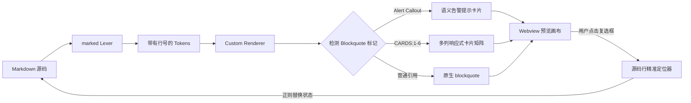

# GitHub Alert Callout 核心思想与现代化多列卡片矩阵

本文档是 OmniView 对 **GitHub Alert Callout「语义标记优先 + 优雅降级优先」核心设计哲学** 的全景演练范本，包含标准 5 大语义提醒块、可折叠手风琴、自定义标题，以及基于该思想衍生的 **多列响应式卡片矩阵（1 行 3/4/6 列）** 与 **交互式 Task List 双向源码回写**。

---

## 💡 GitHub Alert Callout 核心设计哲学 (Design Philosophy)

在 Markdown 中强调关键信息或排版卡片时，业界曾充斥着裸写 HTML（如 `<div class="alert alert-warning">` 或 `<div class="grid grid-cols-3">`）的做法。这种写法不仅破坏了 Markdown 的清爽纯文本阅读感，且在移动端、邮件通知或不支持 HTML 的编辑器中极易造成排版错乱。

GitHub Alert Callout 确立了现代 Markdown 工程排版的四大核心准则：

1. **优雅降级优先 (Graceful Degradation / Fallback First)**：
   - 语法必须寄生在标准 CommonMark 的**原生引用块（`>`）与列表项（`-`）**之上；
   - 在任何古老解析器、纯终端（`cat` / `less`）、Git Diff 或第三方平台中，**100% 自动退化为结构规整的引用段落或无序列表**，正文内容 0 损失、语法树 0 报错。
2. **语义驱动，而非视觉驱动 (Semantic over Presentation)**：
   - 绝不暴露物理样式（如“蓝底”、“加粗红框”），而是定义作者的真实意图（如 `NOTE`、`WARNING`、`CARDS:3`），视觉主题（深浅模式、微浮动、图标、阴影）完全由宿主设计令牌统一呈现。
3. **渐进增强 (Progressive Enhancement)**：
   - 在 OmniView 中，AST 解析引擎自动拦截这些语义标记，将其无缝升级为带 `--ov-*` 语义令牌、SVG 矢量图标、行号回写定位与 CSS 容器查询的现代化交互卡片。
4. **无障碍保障 (Accessibility - a11y)**：
   - 输出符合语义标准的结构（`<div role="alert">` 或标准语义列表），确保屏幕阅读器能准确朗读警示级别与卡片层级。

---

## 一、GitHub / Obsidian 规范 5 大语义提醒块

原生识别 Markdown 引用块中的 `[!TYPE]` 语义指令，渲染为带有专属高对比度左边框、彩色背景光晕与精致矢量图标的现代化卡片。

> [!NOTE]
> 这是标准的 **NOTE 备注卡片**（中性蓝）。用于向读者补充说明上下文背景信息，保持主干逻辑清晰。

> [!TIP] 💡 核心开发技巧与最佳实践
> 这是带有**自定义标题**的 **TIP 技巧卡片**（翡翠绿）。在预览区直接点击任务清单的复选框，系统将通过 `data-task-line` 毫秒级双向回写源码，实现“所见即所点”。

> [!IMPORTANT]
> 这是 **IMPORTANT 重要提醒卡片**（高贵紫）。包含关键业务规则、排期里程碑或不可忽视的核心参数约束。

> [!WARNING]
> 这是 **WARNING 警告卡片**（琥珀黄）。在进行破坏性操作或跨版本升级前，请仔细核对依赖版本以预防异常。

> [!CAUTION]
> 这是 **CAUTION 危险警示卡片**（警示红）。未经授权的直接写库操作可能导致数据丢失或索引不可逆损坏。

### 扩展语义与可折叠手风琴

OmniView 进一步扩展了生态语义，并支持 Obsidian 风格的折叠控制符（`+` 为默认展开，`-` 为默认折叠）：

> [!SUCCESS] 质量门禁回归通过
> 全量 84 个自动化测试套件持续 100% 绿灯回归，工程分层结构无循环依赖与越权访问。

> [!NOTE]+ 详细实现机制剖析（默认展开，点击标题栏右侧箭头可折叠）
> OmniView 使用自定义 marked 渲染器拦截 `blockquote` 语法树，自动提取 `[!TYPE]` 标记，并将其转化为带有原生 `<details>` / `<summary>` 的语义卡片，支持流畅的折叠展开旋转动画。

> [!TIP]- 点击展开查看完整的快捷键支持列表（默认收起）
> - **Ctrl + S / ⌘ + S**：即时保存修改
> - **Ctrl + Z / ⌘ + Z**：撤销编辑
> - **Alt + 双击正文**：激活原地块级专注编辑工作台
> - **双击正文**：精准定位并跳转到 VS Code 源码对应行号
> - **单击复选框**：实时切换任务状态并同步保存

---

## 二、基于 Alert 思想的多列卡片矩阵 (Card Grid)

通过 `> [!CARDS:列数]` 搭配常规无序列表（`- ...`），即可在一行内排布多列卡片流。在标准 Markdown 环境中，它会自动优雅降级为带标题的引用列表。

### 1. 一行 3 列架构能力矩阵 (`> [!CARDS:3]`)

> [!CARDS:3] 核心渲染能力矩阵
> - ### 🚀 极速渲染引擎
>   基于 Web Worker 与 WASM 离线运算
>   - 渲染预算稳定控制在 16ms 内
>   - 支撑万级节点流畅平移缩放
> - ### 🎨 SVG Studio V2
>   专业级矢量几何绘图与对齐系统
>   - 视口焦点几何吸附算法
>   - 实时属性面板与多图元批处理
> - ### 📦 全格式深度融合
>   打破文档边界的统一工作台
>   - 原生 VS Code Webview 双向持久化
>   - 支持 20+ 工业与图表驱动

### 2. 一行 4 列工程质量指标 (`> [!CARDS:4]`)

> [!CARDS:4] 研发流水线质量保障
> - **物理门禁 84/84**<br>全量自动化测试持续 100% 绿灯回归
> - **零侵入降级**<br>标准 CommonMark 解析器下优雅降级为纯文本
> - **自适应断点**<br>支持分屏与移动端视口自动降级折叠
> - **主题原生融合**<br>100% 依托 `--ov-*` 语义令牌，暗色亮色像素级贴合

### 3. 一行 6 列高密度功能集 (`> [!CARDS:6]`)

> [!CARDS:6] 核心格式驱动生态
> - **Markdown**<br>富文本排版
> - **Mermaid**<br>流程与时序图
> - **PlantUML**<br>架构与组件图
> - **Graphviz**<br>依赖拓扑网络
> - **KaTeX**<br>LaTeX 科学公式
> - **Excalidraw**<br>手绘白板图纸

### 4. 独立重点单卡片与折叠卡片矩阵 (`> [!CARD]` / `> [!CARDS:3]-`)

> [!CARD] 💡 独立核心架构原则
> 坚持浏览器端与 VS Code 插件“本地优先与离线可用”底线。所有渲染与计算均在沙箱或 Web Worker 内完成，严禁设计强依赖外部云端服务的不可行方案。

> [!CARDS:3]- 点击展开查看调优卡片矩阵（默认收起）
> - **Worker 线程池**：多核并发编译 Typst 与 Graphviz DOT 脚本
> - **增量 Diff 缓存**：基于 FNV-1a 哈希的秒级 Fiber 复用机制
> - **虚拟视口挂载**：仅为当前视窗可见图表挂载真实 DOM 节点

---

## 三、现代化 CSS 容器查询自适应断点 (Container Queries)

无需在 Markdown 中手写繁琐的 `@media` 媒体查询，OmniView 的卡片网格内置了现代 CSS 容器查询（Container Queries）：

```css
.ov-card-grid-container {
  container-type: inline-size;
}
```

- **宽屏视口（> 1080px）**：完整展示 6 列、4 列或 3 列卡片；
- **分屏/中屏（840px ~ 1080px）**：6 列与 5 列自适应折叠为 3 列，防止内容被挤压；
- **窄屏（580px ~ 840px）**：4 列自适应折叠为 2 列；
- **极端分屏/移动端（< 580px）**：所有网格自动降为单列流式排版，保持最佳字体字号与行距。

---

## 四、交互式 Task List（复选清单）所见即所点

在右侧预览区直接点击下方的复选框，可体验**无缝交互**与**双向源码回写**：

### 🚀 阶段交付清单
- [x] GitHub 风格 Callout 语义卡片（NOTE, TIP, IMPORTANT, WARNING, CAUTION）
- [x] 可选折叠展开语法（`[!NOTE]+` 与 `[!NOTE]-`）
- [x] 自定义 Callout 标题与扩展语义类型
- [x] 基于 GitHub Alert 思想的多列卡片矩阵（`[!CARDS:3]`, `[!CARDS:4]`, `[!CARDS:6]`）
- [x] 独立单卡片（`[!CARD]`）与容器查询自适应断点
- [x] 交互式 Task List 预览区直接点击勾选/取消勾选
- [x] 基于 `data-task-line` 精准反向定位与源码同步修改
- [ ] 导出 A4 物理分页打印配置面板

---

## 五、混合排版与图表内嵌

> [!NOTE] 架构拓扑说明
> 下图展示了从 Markdown 解析到 DOM 渲染、卡片网格升级及双向回写的完整数据流：


