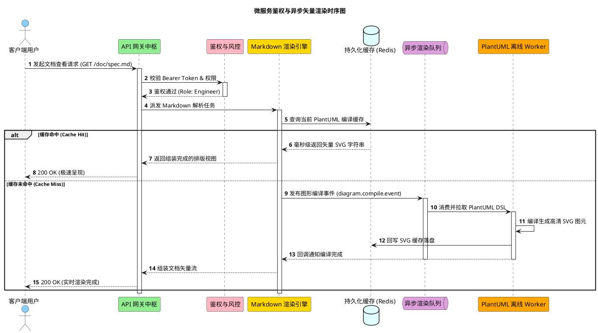
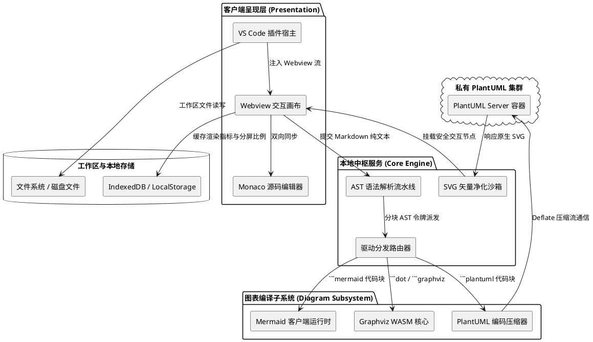
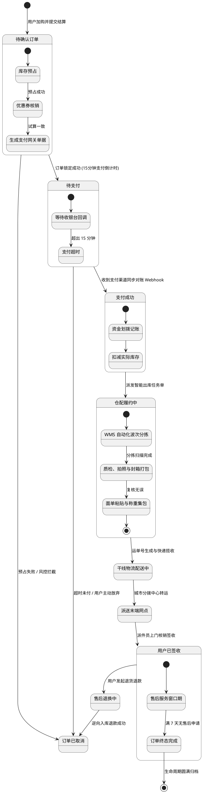
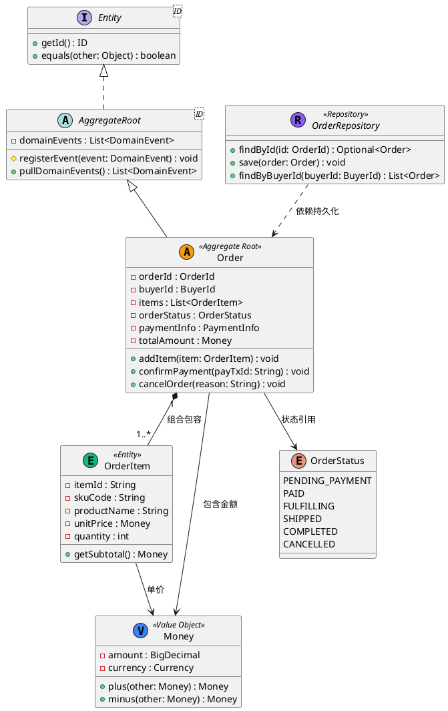
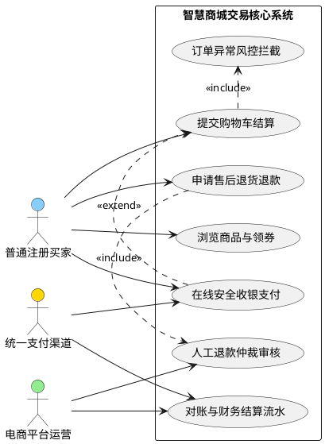
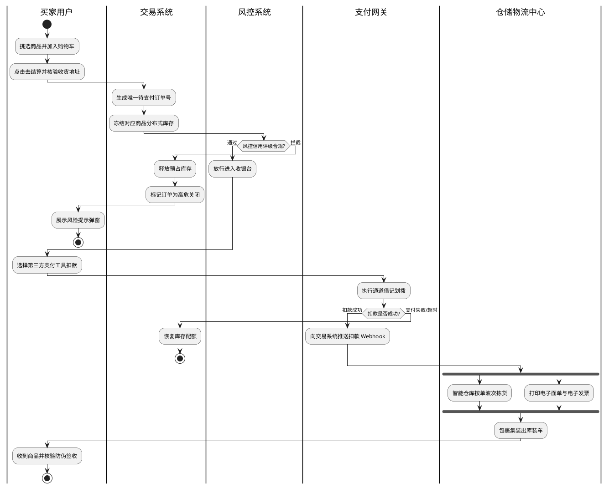
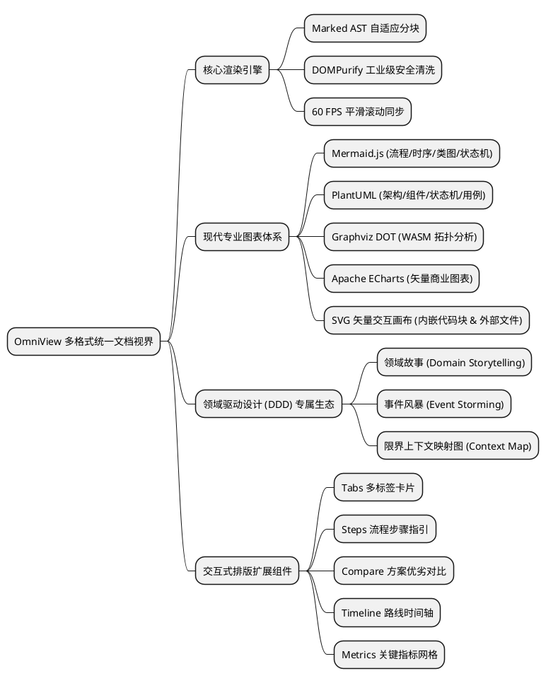

# PlantUML 架构与工程图表全景展馆 (PlantUML Visual Gallery)

> [!BANNER] OmniView PlantUML 专业矢量绘图展馆
> 本文档全面展示 OmniView 对 **PlantUML** 丰富工程与架构图表的解析和矢量渲染能力。
> 支持在【预览 / 源码】模式之间极速切换，双击全屏放大沉浸式检视，多主题高保真自适应渲染！

---

## 一、技术特性与渲染架构概览

> [!TABS]
> - 本地与私有服务架构: OmniView 内置轻量 PlantUML 编码压缩器，同时支持通过【设置 -> PlantUML 服务地址】配置团队私有本地/内网 PlantUML Server 容器（如 `http://localhost:8080`），数据永不出域。
> - 双向源码与预览交互: 在任意 PlantUML 图表右上角点击【源码】即可直接就地微调语法，点击【预览】或 Ctrl+S 实时重新编译渲染，丝滑无卡顿。
> - 外部文件引用联动: 不仅支持在 Markdown 中内嵌代码块，还支持通过 `external` 参数直接无缝加载工作区独立 `.puml` 架构文件。

> [!COMPARE]
> - PlantUML: 适合工业级复杂企业架构、时序生命周期微调、精细包依赖关系、复合状态机与 UML 严格规范建模。
> - Mermaid: 适合轻量内嵌流程图、敏捷快速原型、基础时序与现代网页端轻量可视化。

---

## 二、核心工程图表示例

### 1. 微服务认证与流式渲染时序图 (Sequence Diagram)

展示复杂调用时序、生命周期激活条 (`activate`/`deactivate`)、条件分支 (`alt`/`else`) 与自动序列编号：



---

### 2. 企业级云原生微服务组件与部署图 (Component Diagram)

展示跨网络边界、多层分包 (`package`)、组件依赖与外部服务网关关系：



---

### 3. 分布式交易订单流转复合状态机 (State Machine Diagram)

展示嵌套复合子状态、超时自愈、异常回滚与生命周期终态：



---

### 4. DDD 领域模型与聚合根类图 (Domain Model Class Diagram)

展示实体 (Entity)、值对象 (Value Object)、聚合根 (Aggregate Root) 泛型接口与枚举关系：



---

### 5. 战略业务用例图 (Use Case Diagram with Boundaries)

展示外部角色参与者 (Actor)、业务边界与用例依赖 (`<<include>>`, `<<extend>>`)：

> [!NOTE] 全主题自适应渲染保障
> OmniView 内置多主题自适应渲染引擎，会自动为用例图的 `usecase` 椭圆、边界 `rectangle` 与外部 `actor` 注入高对比度主题样式，彻底杜绝深色模式下常见的“白底白字”显示异常，并支持双击全屏无级放大检视。



---

### 6. 现代活动泳道流程图 (Activity Diagram with Swimlanes)

展示跨部门跨泳道的协作流转、判定与并行汇聚 (`fork`/`join`)：



---

### 7. 架构与知识体系思维脑图 (PlantUML Mindmap)

展示树状发散的架构解耦分解与技术栈全景：

> [!TIP] 现代思维脑图原生样式规范
> PlantUML 脑图基于 `@startmindmap` 语法构建，OmniView 渲染引擎会自动注入原生 `<style>` 脑图图元样式契约，为各层级节点与折叠树枝提供深邃自适应底色与高对比文字，彻底告别传统 PlantUML 脑图节点文字与背景同色的问题。



---

### 8. 外部工作区独立 `.puml` 架构文件挂载

通过 `external` 参数直接无缝加载同工作区内的独立 PlantUML 架构源文件：

```plantuml external="../plantuml/cloud-topology.puml"
```

> [!NOTE] 外部引用提示
> 当使用 `external="../plantuml/cloud-topology.puml"` 时，OmniView 会自动监视源文件的磁盘变动；当上游架构文件修改并保存时，本文档内的图表会自动无缝热重载并同步最新矢量视图！

